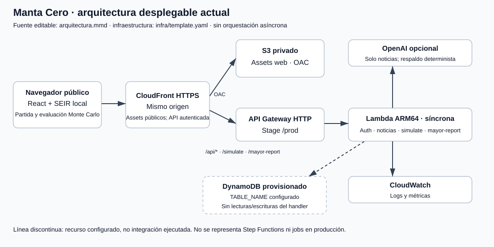
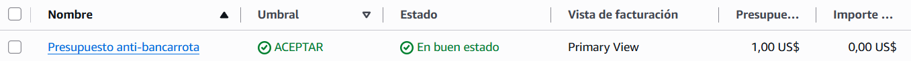

# Manta Cero — Encuentra la cura

Juego de estrategia para navegador de **Operación Manta Cero**, Track B: La Plaga Zombie. Eres el comité de respuesta de Manta: distribuye recursos entre contención e investigación para encontrar la cura antes de que el brote desborde la ciudad.

## Ejecutar

```bash
bun install
# Crea .env.local con INVITE_SESSION_SECRET (ver sección de acceso).
bun run dev
# http://localhost:5173
bun test
bun run build
bun run preview
```

## Inicio de sesión

El botón **Usar acceso de invitado** rellena el correo y la contraseña; después pulsa **Entrar a la operación**. Esta cuenta es pública y compartida: cualquiera con acceso a la aplicación puede usarla, incluidos los endpoints protegidos. Para deshabilitarla configura `DEMO_LOGIN_ENABLED=false` en el servidor y reinícialo; esto también invalida sus sesiones existentes. El botón permanece visible, pero el servidor rechazará esas credenciales.

Para iniciar localmente, crea `.env.local` con `INVITE_SESSION_SECRET` de 32 bytes aleatorios en hexadecimal, por ejemplo con `node -e "console.log(require('crypto').randomBytes(32).toString('hex'))"`. Conserva cualquier otra variable existente. Vite usa `http://localhost:5173` o `http://localhost:4173` como origen por defecto; para otro origen configura `INVITE_APP_ORIGIN` (HTTPS salvo localhost).

Opcionalmente configura una cuenta propia con `LOGIN_EMAIL` y `LOGIN_PASSWORD_SCRYPT` en el servidor. Genera el valor `sal:hash` con `node -e "const c=require('crypto'), s=c.randomBytes(16); console.log(s.toString('hex')+':'+c.scryptSync(process.argv[1],s,64).toString('hex'))" 'CONTRASEÑA'` (evita exponer contraseñas reales en el historial del shell). Cambiar el correo o hash invalida sus sesiones. No hay registro ni recuperación de contraseña.

La API anterior sigue aceptando códigos configurados en `INVITE_CODE_HASHES` para compatibilidad; elimina esa variable para revocarlos. No compartas `.env.local` ni uses `VITE_` para secretos. La cookie es `HttpOnly`, `SameSite=Strict`, `Secure` en HTTPS y dura hasta **8 horas**; hay comprobación de origen, límite de tamaño y cinco intentos por IP/minuto. **Salir** descarta la partida, mientras que recargar conserva el acceso, pero no el progreso. Rota `INVITE_SESSION_SECRET` para revocar todas las sesiones.

**Límites de esta aplicación:** el rate limit es por proceso, no distribuido; antes de escalar necesita control compartido o WAF. Cerrar sesión borra la cookie del navegador, pero una copia robada del token sigue válida hasta caducar o revocar el código/clave. El JavaScript del juego es descargable y la simulación corre en cliente: esto controla el acceso normal y los endpoints, no es DRM ni protege código fuente o datos que se incluyan en assets públicos.

**Despliegue:** El frontend estático y el backend serverless están alojados y unificados en AWS mediante **Amazon CloudFront** y **Amazon S3** (Origin Access Control) junto con **AWS Lambda ARM64** y **API Gateway**. Esto permite servir la UI y los endpoints protegidos (`/api/auth/*`, `/api/news`, `/simulate`, `/mayor-report`) bajo el mismo origen HTTPS seguro, garantizando el funcionamiento de las cookies `HttpOnly; SameSite=Strict` sin fricciones de CORS. La compilación se realiza con `bun run build` para la web y `bun run build:lambda` para el paquete serverless (`build/lambda/handler.mjs`).

## Campaña cinematográfica

El botón **Campaña** abre tres operaciones independientes: hospital (6 días, red operativa, hasta 100 infecciosos en su zona y 15% de investigación), puerto (8 días, 1.800 inmunes y un máximo de 500 infecciosos allí) y cura (100% en 20 días). Cada capítulo usa semilla fija y $7.500 diarios; superar el objetivo permite iniciar el siguiente. La campaña conserva la derrota por 35% de contagios acumulados en toda la ciudad. Incluye presentaciones animadas, objetivos visibles y transmisiones deterministas basadas en los datos reales de cada turno. No guarda progreso y no transfiere recursos entre capítulos. **Nueva misión** vuelve al modo libre.

## Noticias diarias

Cada **Avanzar un día** abre una tarjeta **Última transmisión** con un boletín del COE de Manta. El texto lo redacta un modelo de OpenAI a partir del estado real de la partida: decisiones del día, dinero ejecutado, contagios nuevos y acumulados, crecimiento, carga hospitalaria, avance de la cura, zonas afectadas, escenario y semilla.

- El navegador llama a `POST /api/news`, protegido por la misma cookie de invitación. La clave vive solo en el servidor (`.env.local` en local, variable de entorno en AWS) y **nunca** se envía al cliente ni se usa con prefijo `VITE_`.
- Variables: `OPENAI_API_KEY`, `OPENAI_BASE_URL` (opcional) y `OPENAI_NEWS_MODEL` (`gpt-4o-mini` por defecto). Sin clave, error de red o respuesta inválida, el servidor devuelve un boletín determinista de respaldo, así que la partida nunca se bloquea.
- El modelo recibe solo cifras del juego y redacta en tono operativo, sin especulación política. Los números exactos se muestran en una línea de datos calculada en cliente para evitar cifras inventadas.
- Límites: 20 solicitudes por minuto por IP, cuerpo máximo de 8 KB, timeout de 8 s y caché en memoria por estado. Rate limit y caché son por proceso; antes de escalar necesitan un almacén compartido o un WAF.
- Si la clave se expuso en un chat, un log o un repositorio, rótala en OpenAI. Rotar una clave no cambia el código: actualiza `.env.local` o el parámetro de la plantilla.

## Laboratorio de Investigación y Asistente con Telemetría

El botón **Investigación** abre el entorno de trabajo científico (`ResearchWorkspace`), donde es posible formular hipótesis, editar medidas de intervención personalizadas y dialogar con el asistente de investigación:

- **Telemetría epidemiológica en vivo:** Al consultar al agente (`POST /api/research/agent`), el cliente envía el contexto operativo del día observado (casos activos, acumulados, porcentaje de saturación hospitalaria frente al umbral municipal de 1.200 camas, presupuesto restante y los tres focos urbanos de mayor prevalencia). Esto fundamenta las recomendaciones sin permitir alucinaciones sobre el estado de la epidemia.
- **Pre-evaluación epidemiológica y fiscal en tiempo real:** Toda propuesta de medida generada por el agente o configurada por el usuario es pre-evaluada en memoria (<10 ms) frente a la línea base SEIR determinista (`evaluateMeasureImpact`). Reporta estimaciones inmediatas de contagios evitados, reducción porcentual del pico infeccioso, costo estimado en USD, viabilidad fiscal frente al presupuesto total y alivio del colapso hospitalario.
- **Sesión de voz interactiva:** Admite interacción hablada con transcripción directa, control de interrupción (barge-in) y confirmación explícita antes de aplicar cualquier propuesta al borrador.

## Cómo jugar

En el primer acceso aparece una **práctica interactiva de cuatro pasos**: elegir zona, asignar prevención, financiar la cura y simular un día. Usa el motor real en una partida de práctica separada: no consume recursos ni altera tu misión. Se puede omitir, cerrar con Escape y repetir desde **Cómo jugar**. Solo se recuerda en este navegador que ya cerraste la guía; no se guarda la partida. Si el navegador bloquea el almacenamiento, la guía sigue funcionando, pero vuelve a ofrecerse al recargar.

1. Selecciona una de las 16 zonas del mapa. El mapa 3D está acotado a Manta: no hay vista planeta.
2. Selecciona una zona en el mapa para asignar o retirar vacunación ($2.400 por lote de 850 dosis), fumigación ($1.100), cordón sanitario ($1.900), aislamiento de casos ($1.300) o prevención comunitaria ($700). Las brigadas se reasignan cada día.
3. Financia investigación: $1.200 suma 3 puntos porcentuales diarios; $2.200 suma 5; $0 pausa. La misma bolsa diaria financia investigación y brigadas.
4. Pulsa **Avanzar un día**. El presupuesto se renueva sin acumular sobrantes; el mapa y la barra muestran el resultado y llega la noticia del día.
5. Ganas al completar el 100% de investigación. Pierdes si los contagios acumulados alcanzan el 35% de la población, o al terminar el día 40 sin cura. El umbral de contagios tiene prioridad si coincide con la validación de la cura.

**Una estrategia ganadora verificada:** escenario estándar, semilla `20261030`, $7.500/día; invierte $2.200 en investigación y envía cada día un cordón y un lote de vacunación al nodo con más infecciosos (no vacunes si ya no quedan susceptibles). Completa la cura el día 20 con 13.552 contagios acumulados (5,0% de la población). No se garantiza victoria en todas las semillas/escenarios.

**Nueva misión** permite cambiar las dosis por lote (10–5.000, por defecto 850; atajo de mitad: 425), semilla, origen, presupuesto ($4.000 austeridad / $7.500 emergencia municipal / $11.000 refuerzo COE) y escenario: estándar, doble contagio humano o escape de vacuna. El costo de cada lote sigue en $2.400, incluso con 425 dosis: representa menor disponibilidad, no una rebaja de precio. Campaña y tutorial conservan 850 dosis. Reiniciar o recargar descarta la partida: esta aplicación no guarda progreso.

## Evaluación reproducible

**Evaluar** ejecuta localmente 20 corridas por estrategia hasta el día actual: tu calendario de brigadas, no intervenir, intervención al azar y SGC automática. Reporta promedios y percentiles P10–P90, sin declarar de antemano un ganador. Las líneas base disponen del mismo presupuesto diario; tu plan dedica parte a investigación y ellas solo a contención. Todas empiezan sin intervenciones en el día cero.

La evaluación de tu plan repite el calendario ya elegido; no representa una política adaptativa que tome nuevas decisiones en cada réplica. La gráfica contiene las tres estrategias automáticas, mientras tu plan se muestra en su tarjeta. Los percentiles son dispersión entre corridas, **no intervalos de confianza**. Contagios evitados **no son muertes evitadas**.

## Simulación múltiple y Auditoría de Políticas

El módulo de **Simulación múltiple** (`SimulationDashboard`) permite ejecutar análisis de Monte Carlo desacoplados del renderizado 3D para evaluar la robustez de los planes:

- **Comparación pareada con la Política del Comité:** Si existe una política aprobada y registrada en el servidor, se evalúa contra la estrategia automática de referencia SGC (*Smart Cortafuegos*) usando pares con idéntica semilla e índice sobre el grafo normal de 16 zonas.
- **Métricas e incertidumbre estadística:** Reporta la mejora porcentual frente a SGC, la diferencia pareada promedio (SGC − Candidata), el rango de dispersión P10–P90 y el intervalo de confianza bootstrap al 95% para la diferencia.
- **Gráficas de bandas y auditoría:** Visualiza la evolución diaria con polígonos de banda P10–P90 y exporta las corridas individuales o los pares evaluados a formato CSV (`.csv`) con firma UTF-8 para verificación independiente.
- **Dificultad y partición sintética:** Admite evaluar planes automáticos sobre grafos de 32 y 48 sectores sintéticos con conservación estricta de población.

## Modelo, parámetros y supuestos

- Modelo ficticio educativo SEIR: susceptible, expuesto, infeccioso y recuperado/inmune; la vacuna solo se aplica a susceptibles. `R` incluye tanto recuperación como inmunización. No hay mortalidad modelada.
- Grafo manual de 16 zonas y 22 conexiones inspirado en Manta. Poblaciones, pesos, centralidades y riesgos son aproximaciones de escenario, **no datos epidemiológicos calibrados ni rutas oficiales verificadas**. El mapa 2D es esquemático; el mapa 3D combina imagen satelital de Esri, relieve AWS Terrain Tiles y edificios vectoriales de OpenFreeMap, acotado a la ciudad. Los compuestos 3D por zona son decoración generada, no cartografía real.
- Economía en USD (Ecuador está dolarizado): lote de 850 dosis $2.400 (≈$2,82/dosis con cadena de frío y seis vacunadores), fumigación por zona-día $1.100 (12 operadores y dos termonebulizadores), cordón sanitario $1.900 (Policía Nacional/Fuerzas Armadas y vallas), investigación $1.200 (3 pp/día) o $2.200 (5 pp/día). Presupuestos diarios: $4.000 austeridad municipal, $7.500 emergencia municipal, $11.000 refuerzo del COE Nacional. Son estimaciones de escenario para el juego, no contratos ni precios oficiales.
- Juego estándar: `betaHuman=0.30`, `betaVector=0.045`, `sigma=0.33`, `gamma=0.10`, eficacia vacuna `0.85`, capacidad hospitalaria `2500`, lote `850`, $7.500/día, origen `N01`, 35 infecciosos y 50 expuestos iniciales, semilla `20261030`.
- Doble contagio: `betaHuman=0.60`; escape inmune: eficacia `0.45`. Las demás condiciones permanecen iguales.
- Fumigación reduce el vector ambiental 80% (luego puede recuperarse); cordón reduce transporte 92% y contacto local 55% durante ese turno.
- Aislamiento reduce 50% la presión infecciosa originada en la zona; prevención reduce 30% la transmisión humana recibida en la zona. Ambas duran un turno y sus efectos son supuestos de juego, no estimaciones clínicas.
- Investigación lineal, costos, plazo de 40 días y umbral de 35% son **reglas de diseño del juego**, no predicciones científicas. Al validar la cura termina la misión; no se simula su distribución posterior.
- PRNG Mulberry32 y transiciones binomiales (aproximación normal para grupos grandes). Misma configuración, semilla y decisiones producen la misma partida.
- Requisitos versionados: [`docs/00-especificacion-reto.md`](./docs/00-especificacion-reto.md), contrastados con `hackathon_track_b.md` local. La entrega indicada es el 28 de octubre a las 10:00 (Ecuador); la región figura por confirmar.

## Modo Comité — Aprendizaje de Políticas y Estado Actual

El aprendizaje híbrido de estrategias mediante optimización por método de entropía cruzada (CEM) de cuatro pesos está especificado en [`docs/features/committee-learning/`](./docs/features/committee-learning/README.md):

- **Entrenamiento local fuera de línea:** Implementado en `src/domain/committee/offline.ts` y ejecutable vía `scripts/train-committee.ts`. Utiliza un protocolo de 3.552 trayectorias con validación cruzada y auditoría final frente a SGC.
- **Registro inmutable y evaluación serverless:** `backend/committee/policyRegistry.ts` gestiona versiones inmutables y metadatos protegidos fuera de prefijos efímeros de S3; `backend/committee/evaluation.ts` ejecuta evaluaciones pareadas en backend.
- **Handoff y estado de producción:** Siguiendo la decisión de producto vigente, la Simulación múltiple evalúa versiones congeladas y aprobadas. Los endpoints duraderos de entrenamiento y evaluación en servidor se mantienen protegidos con 503 hasta completar el ciclo de admisión y cuotas en background. El estado detallado y la hoja de ruta se encuentran en [`docs/features/committee-learning/_audit/remaining-2026-10-28.md`](./docs/features/committee-learning/_audit/remaining-2026-10-28.md).

## Estructura

- `src/App.tsx` — shell de pantalla completa: mapa, HUD de situación, barra inferior de mando (presupuesto, zona, plan, cura, día, intervenciones, laboratorio), transición de día y diálogos.
- `src/components/CureEarth3DMap.tsx` — mapa 3D MapLibre acotado a Manta, sin vista planeta; `src/components/CureCityMap.tsx` — mapa SVG táctico.
- `src/components/DayTransition.tsx` — reporte diario animado; duración única en `DAY_TRANSITION_MS`.
- `src/components/NewsFlash.tsx` — tarjeta **Última transmisión** con datos exactos del estado.
- `src/domain/economy.ts` — costos USD y niveles de presupuesto de la respuesta municipal/nacional.
- `src/domain/cureGame.ts` — reglas y validación del juego; reutiliza el motor SEIR.
- `src/domain/seirEngine.ts` — simulación compartida y calendario opcional de acciones manuales.
- `src/domain/monteCarlo.ts` — baselines y agregación; la aplicación calcula solo al pedir evaluación.
- `src/domain/newsModel.ts` — contrato, prompt editorial y boletín determinista de respaldo.
- `src/domain/newsClient.ts` — llamada a `/api/news` con reserva local ante cualquier fallo.
- `src/domain/__tests__/`, `backend/__tests__/`, `tests/e2e/` — reproducibilidad, economía, conservación, victoria/derrota, esquemas Zod, agregador, workers, reconciliación y smoke tests (288 pruebas automatizadas pasando en 53 archivos con `bun test`).
- `src/InvitationGate.tsx`, `src/access.css` — pantalla de acceso y ciclo de sesión.
- `backend/auth.ts`, `backend/devAuth.ts` — validación compartida y adaptador local Vite con `/api/news`.
- `backend/news.ts`, `backend/handler.ts`, `infra/template.yaml` — generación del boletín, endpoints protegidos y plantilla AWS SAM desplegada en producción.
- `src/research/ResearchWorkspace.tsx`, `src/research/research.css` — entorno interactivo de investigación, panel de medidas y diálogo con el agente.
- `src/domain/researchEvaluation.ts` — pre-evaluación epidemiológica y de viabilidad presupuestaria de medidas experimentales.
- `src/components/SimulationDashboard.tsx` — panel de simulación múltiple, bandas P10–P90 y comparador pareado con política del Comité.
- `src/domain/policyEvaluation.ts`, `src/domain/simulationAudit.ts` — evaluación pareada, agregación de bandas y exportación CSV.
- `src/domain/committee/offline.ts`, `scripts/train-committee.ts` — motor offline de optimización CEM de 4 pesos y CLI de entrenamiento.
- `backend/committee/` — registro inmutable de políticas (`policyRegistry.ts`), almacén de evaluaciones (`evaluationStore.ts`, `resultStore.ts`) y evaluación pareada (`evaluation.ts`).
- `backend/researchAgent.ts` — endpoint de investigación con telemetría en vivo y evaluación integrada.
- `.github/workflows/deploy.yml` — pipeline de CI/CD para testeo y auto-despliegue continuo en AWS.

## Despliegue y Arquitectura Cloud en AWS (Producción)

La infraestructura registrada está en **`us-east-1`**. La partida y su evaluación se ejecutan en el navegador; los endpoints Lambda son síncronos. Los módulos experimentales de jobs no forman parte del despliegue.



[Fuente editable del diagrama](./docs/arquitectura.mmd) · [Plantilla SAM](./infra/template.yaml). DynamoDB está provisionado, pero el handler actual no lo usa. OpenAI es opcional para noticias; sin clave se utiliza el respaldo determinista. El informe ejecutivo no invoca Bedrock.

- **URL Pública en Vivo (CloudFront):** [https://d1jqe51rtigrcl.cloudfront.net](https://d1jqe51rtigrcl.cloudfront.net)
- **API Gateway Endpoint:** `https://n4n7yll0f4.execute-api.us-east-1.amazonaws.com/prod`
- **Cómputo Serverless:** AWS Lambda ARM64 (Graviton2) con Node.js 20.
- **Base de Datos:** Amazon DynamoDB (`SpookythonSimulations`) en modo On-Demand.
- **Hosting Frontend:** Amazon S3 privado con Origin Access Control (OAC) y CDN global CloudFront.

### Verificación en Vivo del Backend Cloud

Prueba opt-in con tráfico real y pequeño costo potencial. Lee `.invite-code.local`; no imprime el código ni la cookie. Falla con salida distinta de cero si autenticación, flags de cookie, determinismo, informe o logout no cumplen. Comparar resultados numéricos excluye timestamps y duración. No reemplaza la prueba de navegador:

```bash
VERIFY_ENDPOINT="https://d1jqe51rtigrcl.cloudfront.net" \
INVITE_APP_ORIGIN="https://d1jqe51rtigrcl.cloudfront.net" bun run verify:cloud
```

### Control de Presupuesto y Costos (AWS Budgets)

Una alerta de AWS Budgets no corta el consumo ni garantiza gratuidad. La consulta de cuenta del 27 de octubre verificó un presupuesto mensual de **$1 USD**, alerta de gasto real superior a **$0,01 USD** y un suscriptor de correo. La captura histórica puede no reflejar esa configuración actual. Ver [costos, fuentes y mediciones](./docs/costos.md).



### Auto-deploy Continuo (CI/CD)

Cada commit sobre la rama `main` dispara el flujo de GitHub Actions ([`.github/workflows/deploy.yml`](.github/workflows/deploy.yml)):
1. Ejecución de la suite completa de pruebas con Bun (`bun test`).
2. Compilación del bundle de Lambda (`bun run build:lambda`) y assets web (`bun run build`).
3. Empaquetado y despliegue de infraestructura con **AWS SAM CLI**.
4. Sincronización de artefactos web en Amazon S3 (`aws s3 sync dist/`).
5. Invalidación automática de la caché perimetral en Amazon CloudFront.

## Desplegar y recuperar

### Preparación

Necesitas Bun 1.3.14, AWS CLI, SAM CLI y credenciales autorizadas en `us-east-1`.
No publiques `.env.local`, códigos, claves de firma ni credenciales. Usa variables
de entorno locales y secretos de GitHub; nunca valores literales en comandos compartidos.

| Secreto de GitHub | Uso |
| --- | --- |
| `AWS_ACCESS_KEY_ID`, `AWS_SECRET_ACCESS_KEY` | Identidad de despliegue |
| `INVITE_CODE_HASHES` | Hashes SHA-256 de invitaciones, separados por comas |
| `INVITE_SESSION_SECRET` | Nueva clave aleatoria de 32 bytes, representada con 64 hexadecimales |
| `INVITE_APP_ORIGIN` | Origen HTTPS exacto de CloudFront, sin barra final |

Configura los mismos nombres en el entorno local. `bun run invite` prepara las
invitaciones locales, pero **no** configura GitHub ni AWS. Nunca reutilices la
antigua clave de respaldo publicada: rota la clave desplegada y el secreto de
GitHub; todas las sesiones anteriores quedarán invalidadas. El pipeline falla
antes de acceder a AWS si falta algún secreto o el formato/origen es inseguro.
No acepta una distribución CloudFront ajena como origen.

### Compilar y desplegar (Bash)

Los siguientes comandos producen cambios en AWS: ejecútalos solo tras revisar
el diff, las pruebas y el changeset. No incluyen eliminación del stack ni de datos.

```bash
bun install --frozen-lockfile
bun test
bun run build
bun run build:lambda
bun scripts/validate-deploy-env.ts
sam validate --template-file infra/template.yaml --region us-east-1
sam build --template-file infra/template.yaml
sam deploy --stack-name spookython-manta-cero --region us-east-1 \
  --capabilities CAPABILITY_IAM --resolve-s3 --confirm-changeset \
  --parameter-overrides InviteCodeHashes="$INVITE_CODE_HASHES" \
    InviteSessionSecret="$INVITE_SESSION_SECRET" InviteAppOrigin="$INVITE_APP_ORIGIN" \
  --no-fail-on-empty-changeset
```

**Primer stack:** aún no conoces el dominio CloudFront. Usa temporalmente
`INVITE_APP_ORIGIN=https://bootstrap.invalid` para crear el stack; el acceso de
navegador real no estará habilitado. Obtén `CloudFrontUrl` en los outputs, cambia
`INVITE_APP_ORIGIN` por ese origen exacto y repite `sam deploy` con todos los
parámetros anteriores. Luego guarda el origen definitivo en GitHub. No dejes
el origen provisional ni `localhost` en producción. En un stack existente usa
desde el principio el origen real, no el provisional.

```bash
aws cloudformation describe-stacks --stack-name spookython-manta-cero \
  --region us-east-1 --query 'Stacks[0].Outputs' --output table
# Copia FrontendBucketName y el ID de la distribución (no son secretos).
aws s3 sync dist/ "s3://$FRONTEND_BUCKET" --delete
aws cloudfront create-invalidation --distribution-id "$DISTRIBUTION_ID" --paths '/*'
VERIFY_ENDPOINT="$INVITE_APP_ORIGIN" bun run verify:cloud
```

La distribución y sus cambios tardan en propagarse: espera el estado `Deployed`
antes del smoke. `--delete` elimina assets remotos ausentes de `dist/`: verifica
el nombre del bucket antes de sincronizar. Para encontrar el ID, consulta
`aws cloudfront list-distributions` y selecciona **solo** el dominio del output.
Finalmente prueba en navegador: login, tutorial, partida, lote de 425 dosis,
evaluación, noticia y logout, sin cookies/secretos en capturas o logs.

OpenAI es opcional. La plantilla admite `OpenAiApiKey` y `OpenAiNewsModel`, pero
el workflow actual no suministra la clave. Mantén el fallback sin clave o configura
esos parámetros mediante el procedimiento seguro de despliegue de tu equipo;
no añadas una clave al frontend ni supongas que Bedrock redacta el boletín.

### Rollback

Conserva el SHA y los artefactos de la última versión verificada antes de desplegar.
Para recuperar código, recompila esa versión en un directorio limpio y vuelve a
desplegar Lambda/SAM y sus assets S3 juntos; invalida CloudFront y repite el smoke.
Conserva el origen y la **clave nueva segura**: nunca restaures el secreto publicado.
Si CloudFormation falla, inspecciona su estado/eventos y espera a que finalice el
rollback antes de otro despliegue. No borres DynamoDB, el bucket ni el stack como
atajo de recuperación. Antes de rotar registra que el efecto esperado es cerrar
todas las sesiones; no reintroduzcas una clave expuesta para conservarlas.

### Evidencia y límites

La suite incluye una matriz de tres semillas y cuatro condiciones (estándar,
doble contagio, escape y 425 dosis), 20 corridas por estrategia durante 30 días.
Verifica determinismo, conservación, presupuesto y percentiles ordenados; imprime
medias y resultado comparativo sin exigir una victoria universal. No prueba todas
las semillas, dispositivos ni AWS. Los smoke de `tests/e2e` son integración en memoria,
no navegador ni Step Functions. `livesSaved*` y `costPerLifeSaved` son nombres legacy
del JSON para contagios evitados: no se modelan muertes. El pitch queda fuera de
este cambio. La publicación del repositorio y la entrega en plataforma son pasos
separados que debe confirmar el equipo.
