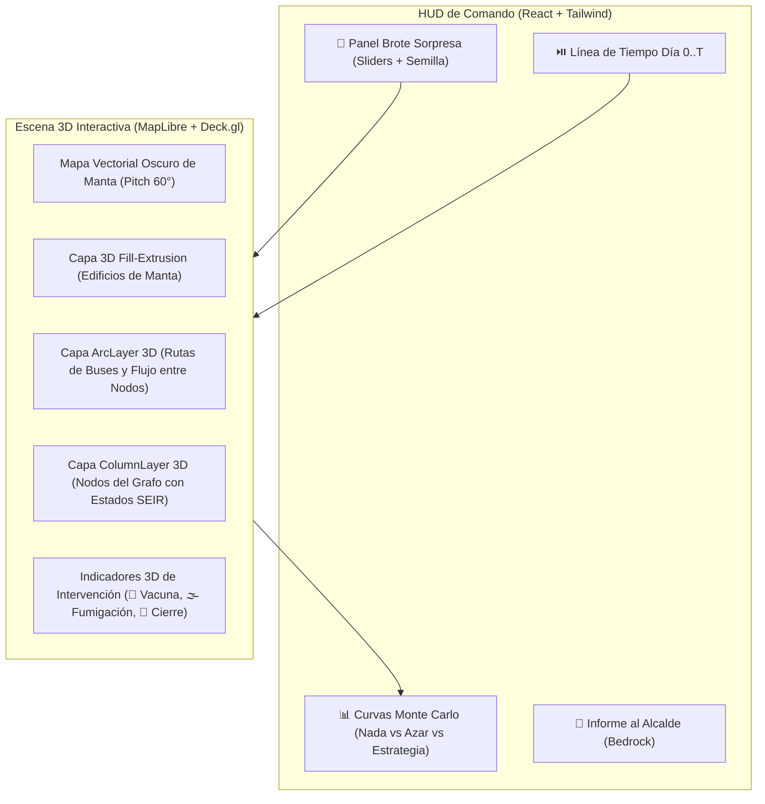

# Ciudad 3D y Grafo Urbano de Manta

La interfaz principal presenta a **Manta en 3D** como un centro de mando táctico donde los edificios reales de la ciudad sirven de contexto geográfico y encima flota el **grafo matemático $G = (V, E)$** con nodos y aristas luminosas que evolucionan día a día.

---

## Ruta Rápida de Implementación 3D

1. **Motor Base Gratuito:** `MapLibre GL JS` con tiles vectoriales de OpenFreeMap (cero API keys pagas, cero costo por carga) centrado en Manta (`lat: -0.9538, lng: -80.7286`, `pitch: 60°`, `bearing: -25°`).
2. **Edificios 3D (`fill-extrusion`):** Extrusión tridimensional de las manzanas de Manta en tonos oscuros (*Dark Slate / Spooky Indigo*) para que los colores brillantes del grafo resalten con máximo contraste.
3. **Capa de Grafo 3D (`Deck.gl` superpuesto a MapLibre):**
   - `ColumnLayer` + `ScatterplotLayer`: Nodos 3D cuya altura y anillo de color reflejan la distribución en tiempo real de 🟢 `S`, 🟡 `E`, 🔴 `I`, 🔵 `R` y el aura de foco infeccioso.
   - `ArcLayer`: Aristas parabólicas en 3D que conectan los barrios según las rutas de buses y flujos comerciales.

---

## Arquitectura Visual de Capas

---

## Topología del Grafo de Manta: Nodos ($V$)

Para lograr equilibrio entre realismo geográfico de Manta, velocidad de cómputo en Monte Carlo (cientos de corridas en <2 segundos) y claridad visual en 3D, la ciudad se modela mediante **16 Nodos Estratégicos** calibrados con proporciones demográficas reales (INEC / GAD Manta):

| ID | Nombre del Nodo | Categoría | Coordenadas Aprox. (`lat, lng`) | Población Base ($N_v$) | Riesgo Ambiental Base (Dengue/Vector) | Rol en el Grafo |
| :--- | :--- | :--- | :---: | :---: | :---: | :--- |
| `N01` | **Mercado Central de Tarqui** | Comercial / Mercado | `-0.9585, -80.7089` | 18,000 | Muy Alto (`0.85`) | **Super-propagador comercial**; altísimo grado de conexión. |
| `N02` | **Playita Mía (Tarqui)** | Pesquero / Mercado | `-0.9512, -80.7095` | 12,000 | Muy Alto (`0.90`) | Foco costero y comercial de madrugada; alta humedad/vector. |
| `N03` | **ULEAM (Campus Principal)** | Educación Superior | `-0.9531, -80.7456` | 22,000 | Medio (`0.40`) | **Hub estudiantil**; conecta jóvenes de todos los barrios de Manta. |
| `N04` | **Hospital Rodríguez Zambrano** | Salud Crítica | `-0.9628, -80.7412` | 6,000 | Bajo (`0.25`) | **Nodo crítico de salud**; recibe flujo de infectados y define el umbral de colapso. |
| `N05` | **Terminal Terrestre de Manta** | Transporte Masivo | `-0.9689, -80.6892` | 15,000 | Medio (`0.50`) | **Puerta de entrada/salida** y nodo puente hacia Eloy Alfaro y Los Esteros. |
| `N06` | **Mall del Pacífico / Murciélago** | Comercial / Recreación | `-0.9425, -80.7314` | 16,000 | Bajo (`0.20`) | Concentrador de alto flujo vespertino y fines de semana. |
| `N07` | **Centro de Manta (Av. 2 / Banco)** | Administrativo | `-0.9478, -80.7225` | 19,000 | Medio (`0.45`) | **Puente central** entre el oeste (ULEAM/Barbasquillo) y el este (Tarqui/Esteros). |
| `N08` | **Parroquia Eloy Alfaro (Cuba)** | Residencial Denso | `-0.9810, -80.6980` | 35,000 | Alto (`0.75`) | Alta densidad habitacional; principal origen de trabajadores hacia mercados y centro. |
| `N09` | **Parroquia Los Esteros** | Residencial / Industrial | `-0.9560, -80.6950` | 28,000 | Alto (`0.80`) | Conecta zona atunera/industrial con Tarqui. |
| `N10` | **San Mateo** | Periférico / Pesquero | `-0.9590, -80.8090` | 8,000 | Medio (`0.55`) | Nodo periférico oeste con baja conectividad (fácil de aislar con cordón). |
| `N11` | **Barbasquillo / Zona Hotelera** | Turístico / Residencial | `-0.9460, -80.7560` | 10,000 | Bajo (`0.20`) | Conectado con ULEAM y Mall del Pacífico. |
| `N12` | **Colegio Manta / Red Escolar Centro** | Educación Secundaria | `-0.9545, -80.7190` | 14,000 | Medio (`0.50`) | Amplificador temprano de contagios domésticos. |
| `N13` | **Zona Industrial Atunera (Vía Rocafuerte)** | Industrial | `-0.9620, -80.6780` | 17,000 | Medio (`0.60`) | Turnos rotativos que mezclan población de Eloy Alfaro, Esteros y Montecristi. |
| `N14` | **Ciudadela Universitaria / Umiña** | Residencial | `-0.9510, -80.7380` | 16,000 | Bajo (`0.30`) | Puente directo entre ULEAM, Hospital y Centro. |
| `N15` | **Puerto Marítimo de Manta** | Logístico / Portuario | `-0.9370, -80.7200` | 9,000 | Medio (`0.45`) | Conectado con Centro y corredor industrial. |
| `N16` | **Urbirríos / Vivienda Popular** | Residencial Denso | `-0.9920, -80.6850` | 25,000 | Alto (`0.80`) | Gran reservorio poblacional conectado por líneas de bus al Terminal y Tarqui. |

---

## Aristas del Grafo ($E$): Rutas de Contagio en 3D

Cada arista $e = (u, v) \in E$ tiene un peso base $w_{uv} \in [0, 1]$ que representa la fracción diaria de población que interactúa entre el nodo $u$ y el nodo $v$ (líneas de buses urbanos FETUM, transporte escolar y flujo comercial):

- **Corredor Este-Centro:** `Urbirríos (N16)` $\leftrightarrow$ `Eloy Alfaro (N08)` $\leftrightarrow$ `Mercado Tarqui (N01)` $\leftrightarrow$ `Centro (N07)`.
- **Corredor Costero-Industrial:** `Zona Industrial (N13)` $\leftrightarrow$ `Terminal (N05)` $\leftrightarrow$ `Los Esteros (N09)` $\leftrightarrow$ `Playita Mía (N02)` $\leftrightarrow$ `Mercado Tarqui (N01)`.
- **Corredor Universitario-Oeste:** `Centro (N07)` $\leftrightarrow$ `Umiña (N14)` $\leftrightarrow$ `ULEAM (N03)` $\leftrightarrow$ `Hospital (N04)` $\leftrightarrow$ `Barbasquillo (N11)` $\leftrightarrow$ `San Mateo (N10)`.
- **Puentes Transversales:**
  - `Eloy Alfaro (N08)` $\leftrightarrow$ `ULEAM (N03)` (líneas estudiantiles directas).
  - `Mercado Tarqui (N01)` $\leftrightarrow$ `Colegio Manta (N12)` $\leftrightarrow$ `Umiña (N14)`.
  - `Centro (N07)` $\leftrightarrow$ `Mall del Pacífico (N06)` $\leftrightarrow$ `Puerto (N15)`.

---

## Codificación Visual 3D en Tiempo Real

| Elemento en el Mapa 3D | Qué Representa | Comportamiento Visual |
| :--- | :--- | :--- |
| **Cilindro 3D Apilado / Color del Nodo** | Estado epidemiológico del barrio en el día $t$ | Verde esmeralda (sano), Ámbar (incubando), Rojo neón (dominado por zombies), Cian brillante (protegido/exorcizado). |
| **Altura del Cilindro 3D** | Cantidad de casos activos (🟡 `E` + 🔴 `I`) o población total (intercambiable en UI) | Crece verticalmente sobre los edificios de Manta cuando el barrio entra en crisis. |
| **Halo Pulsante en el Suelo** | Nivel de Foco Vectorial ($\beta_v$, Necro-Dengue) | Anillo violeta/verde tóxico alrededor del nodo; desaparece cuando se envía una 🌫️ **Brigada de Fumigación**. |
| **Arco 3D (`ArcLayer`)** | Ruta de contagio entre dos nodos | Grosor proporcional al flujo $w_{uv}$; se tiñe de rojo intenso cuando transporta zombies; cambia a línea punteada azul cuando hay 🚧 **Cordón Sanitario**. |
| **Selección por Clic Directo** | Inspector de Nodo + Paciente Cero | Al hacer clic sobre cualquier nodo 3D en la ciudad, se abre su ficha demográfica y permite marcarlo como **Punto de Inicio del Brote**. |

---

## Checklist de Experiencia de Usuario (Criterio Producto 15%)

- [x] Cualquier persona entiende en 5 segundos dónde nació el brote y hacia qué barrios se está moviendo gracias a los arcos 3D.
- [x] Conmutador instantáneo en cámara 3D para alternar entre **"Vista Sin Intervención"**, **"Vista Al Azar"** y **"Vista Nuestra Estrategia"**.
- [x] Selector de un clic en el nodo 3D para cambiar el Paciente Cero durante el **Brote Sorpresa**.

## Siguiente Paso

Ver las ecuaciones exactas de transición diaria, reproducibilidad con semilla y el algoritmo de optimización en [`03-modelo-matematico-y-estrategia.md`](./03-modelo-matematico-y-estrategia.md).
