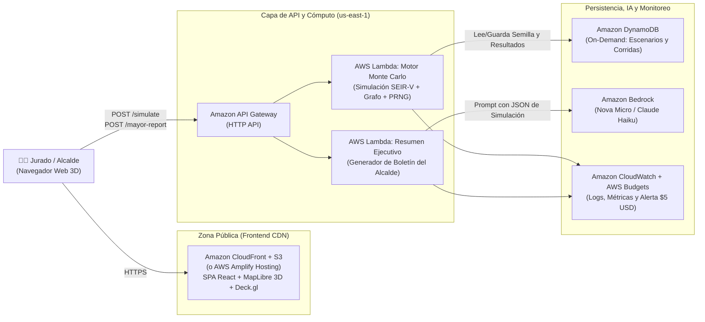

# Arquitectura AWS Serverless y Declaración de Costos

Esta arquitectura está diseñada para cumplir dos objetivos simultáneos de la rúbrica: **ejecutar cientos de simulaciones Monte Carlo en segundos** (Calidad Técnica 25% + Nivel Pro) y **mantener el costo operativo real en $0.00 USD dentro de la Capa Gratuita de AWS** (Costos 10% + Criterio de Desempate).

---

## Diagrama de Arquitectura (`us-east-1`)

---

## Justificación de Servicios Elegidos

| Servicio AWS | Rol en el Proyecto | Por qué es la mejor decisión arquitectónica |
| :--- | :--- | :--- |
| **AWS Amplify / S3 + CloudFront** | Hosting del Dashboard 3D y Grafo | Entrega estática global con HTTPS automático, cero servidores que mantener y cubierto por el Free Tier. |
| **Amazon API Gateway (HTTP API)** | Punto de entrada REST (`POST /simulate`, `POST /report`) | Hasta 70% más barato y con menor latencia que REST API tradicional; primer millón de llamadas gratis. |
| **AWS Lambda (ARM64 / Graviton2)** | Ejecución del motor Monte Carlo (Nada vs. Azar vs. Estrategia) | Escala instantáneamente durante el pitch, cobra $0 cuando nadie lo usa, y con arquitectura `arm64` ofrece hasta 34% mejor rendimiento/precio. |
| **Amazon DynamoDB (On-Demand)** | Caché determinista por `(seed, params_hash)` e historial de corridas | Si el jurado repite la misma semilla y parámetros, responde en `<15 ms` verificando reproducibilidad instantánea. 25 GB y 200M de peticiones gratis al mes. |
| **Amazon Bedrock (Nova Micro / Haiku)** | Redacción del *"Informe para el Alcalde en lenguaje simple"* (Nivel Pro) | Convierte las métricas matemáticas en un boletín ejecutivo claro para autoridades municipales por ~$0.0001 por reporte. |
| **AWS Budgets + CloudWatch** | Gobernanza de costos y observabilidad | Cumple el requisito obligatorio (`DEBE`) de tener alerta presupuestaria desde el Día 1. |

---

## Seguridad Básica Aplicada (Rúbrica Calidad Técnica 25%)

1. **Cero llaves (`AWS_ACCESS_KEY_ID`) en el código o repositorio:** Todo acceso entre Lambda, DynamoDB y Bedrock utiliza **IAM Roles de ejecución** temporales.
2. **Principio de Mínimo Privilegio (Least Privilege):**
   - El rol de `LambdaSim` solo tiene permisos `dynamodb:GetItem` y `dynamodb:PutItem` sobre el ARN exacto de la tabla `SpookythonSimulations`.
   - El rol de `LambdaAI` solo tiene permiso `bedrock:InvokeModel` sobre el modelo ligero seleccionado.
3. **CORS y Rate Limiting en API Gateway:** Throttling configurado (ej. `20 req/s` burst) para impedir que un bucle accidental dispare costos durante la demo.

---

## Declaración de Costos (Base para `docs/costos.md`)

### 1. Costo Real Durante la Hackathon (48 horas de desarrollo + día del Pitch)

| Servicio | Uso Estimado en el Evento | Límite Capa Gratuita (AWS Free Tier) | Costo Real Facturado |
| :--- | :--- | :--- | :---: |
| **AWS Lambda** | ~2,000 ejecuciones (512 MB, ~800 ms c/u) | 1,000,000 ejecuciones + 400,000 GB-s / mes | **$0.00 USD** |
| **API Gateway (HTTP)** | ~2,500 peticiones | 1,000,000 peticiones / mes | **$0.00 USD** |
| **Amazon DynamoDB** | ~4,000 lecturas/escrituras (< 5 MB) | 25 GB + 25 WCU/RCU permanentes | **$0.00 USD** |
| **S3 + CloudFront / Amplify** | ~500 MB transferencia | 5 GB S3 + 1 TB CloudFront / mes | **$0.00 USD** |
| **Amazon Bedrock (Nova Micro)** | ~100 informes para el Alcalde (~800 tokens c/u) | Pago por uso ($0.000035 / 1K input tokens) | **~$0.01 USD** |
| **AWS Budgets + CloudWatch** | 1 Budget con alerta + <50 MB logs | Primer budget gratis + 5 GB logs gratis | **$0.00 USD** |
| **TOTAL EVENTO** | | | **~$0.01 USD** |

### 2. Proyección de Costo Operativo Mensual en Producción (GAD Municipal de Manta)

Suponiendo que el Comité de Salud de Manta ejecuta **30,000 simulaciones Monte Carlo al mes** (1,000 corridas diarias de planificación) y genera **1,000 informes ejecutivos** con IA:

- **AWS Lambda (30,000 invocaciones x 1s @ 1024 MB):**
  - Cómputo: $30,000 \times 1\text{ s} \times 1\text{ GB} = 30,000\text{ GB-s}$.
  - Con Free Tier permanente (400,000 GB-s gratis): **$0.00 USD/mes**.
  - Sin Free Tier ($0.0000133334 por GB-s en ARM64 + $0.20/1M req): **$0.41 USD/mes**.
- **Amazon API Gateway (35,000 llamadas HTTP API):** **$0.04 USD/mes** (sin Free Tier).
- **Amazon DynamoDB (On-Demand, 60,000 escrituras/lecturas):** **$0.08 USD/mes** (sin Free Tier).
- **Hosting Frontend (S3 + CloudFront, 10 GB/mes):** **$0.85 USD/mes** (sin Free Tier; **$0.00** con Free Tier).
- **Amazon Bedrock (1,000 reportes con Amazon Nova Micro):** **$0.05 USD/mes**.

> **Costo Mensual Total Estimado:** **$0.05 USD/mes** (con Free Tier activo) o **$1.43 USD/mes** (tarifa plena sin Free Tier).

---

## Checklist de Configuración AWS (Hacer Hoy)

- [ ] Crear **AWS Budget** mensual de `$5.00 USD` con alerta al 80% y guardar captura en `docs/budget.png`.
- [ ] Verificar que todos los recursos se desplieguen en `us-east-1`.
- [ ] Exportar el diagrama definitivo en `docs/arquitectura.png` y su fuente editable `docs/arquitectura.drawio`.

## Siguiente Paso

Revisar el protocolo para la Prueba de Fuego, el Brote Sorpresa y la división del trabajo para los 3 integrantes en [`05-prueba-de-fuego-y-plan-equipo.md`](./05-prueba-de-fuego-y-plan-equipo.md).
