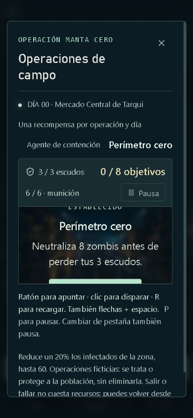
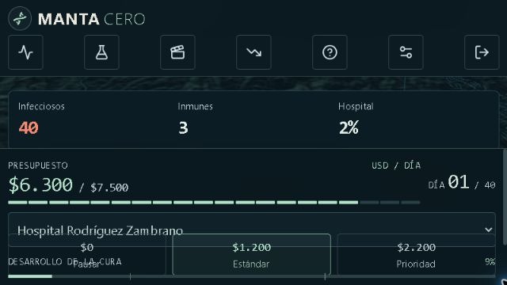
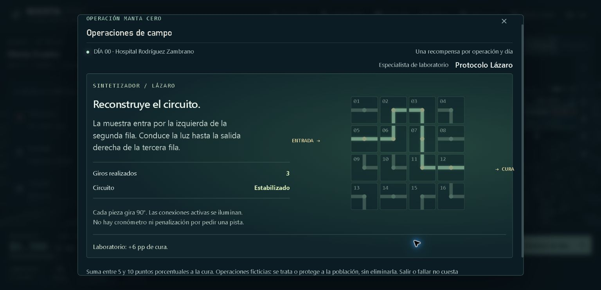
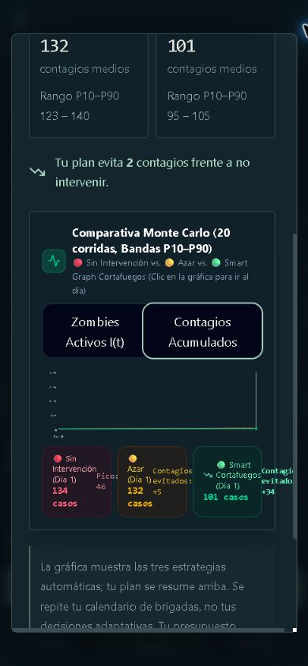
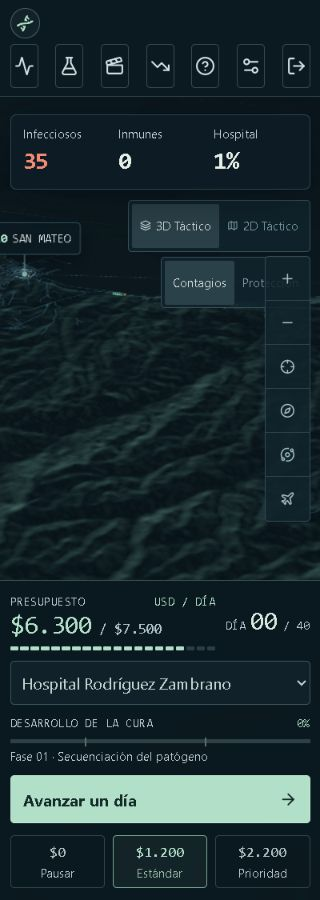
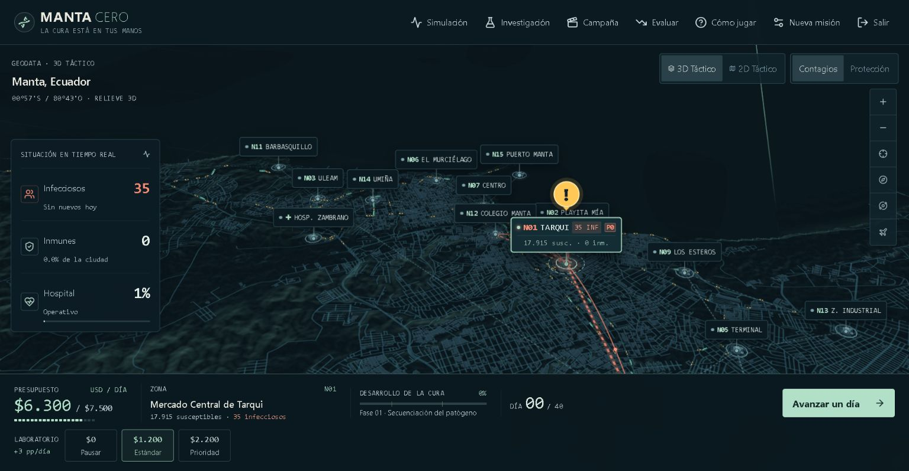
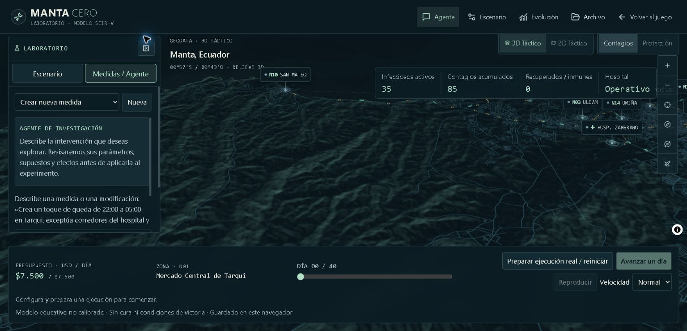

# Auditoría de interfaz y accesibilidad · 28 de octubre de 2026

## Dictamen

[Seguro] Aumentar la tipografía mejoró la lectura, pero no resolvió la accesibilidad. La revisión encontró **4 problemas P1 y 6 P2 de interfaz**, más **2 riesgos P2 de rendimiento**. No se modificó código de la aplicación durante esta auditoría.

[Probable] Conviene corregir los P1 antes de presentar la interfaz como accesible. Este informe **no certifica conformidad WCAG**.

## Método y alcance

- [Seguro] Trabajo de cuatro agentes: teclado/semántica, estilos/contraste, renderizado/rendimiento y verificación integrada en navegador.
- [Seguro] Inspección del estado local sin commit y navegación en una pestaña de prueba de `http://localhost:5173/`, independiente de la partida del usuario.
- [Seguro] Pruebas en escritorio y viewports de **390×844, 320×900 y 640×360 CSS px**. Se revisaron operaciones, laboratorio, ajustes, comparativa, noticias e investigación. Las capturas de este informe se guardaron y se inspeccionaron durante esta ejecución.
- [Seguro] Se midieron geometría, foco activo, estilos calculados y contraste de pares concretos. Se consultaron las explicaciones oficiales de WCAG 2.2.
- [Seguro] No se ejecutaron NVDA/JAWS/VoiceOver, axe, una matriz completa de estados de contraste, escalado exclusivo de texto al 200%, colores forzados, hardware táctil real ni perfiles FPS/GPU. Probar 320 px no equivale a haber probado todas las configuraciones de zoom. Los mapas y juegos tienen excepciones de reflujo; no se considera fallo que el mapa entero no quepa sin desplazamiento.

## Valoración orientativa

[Suposición] Esta escala interna resume la revisión técnica; **no es una puntuación WCAG ni una medición de rendimiento**.

| Dimensión | Puntos / 4 | Motivo |
|---|---:|---|
| Accesibilidad | 2 | Hay nombres, foco visible e instrucciones; faltan operación de gráfica por teclado y continuidad de foco. |
| Rendimiento | 2 | Pausas y limpiezas correctas; dos mapas iniciales y trabajo continuo pendiente de perfilar. |
| Responsive | 1 | Recortes y solapamientos reproducidos en móvil y poca altura. |
| Tokens/consistencia | 2 | Variables compartidas, pero conviven CSS, utilidades Tailwind y texto SVG con escalas diferentes. |
| Patrones visuales | 3 | Identidad táctica reconocible; la densidad y los offsets rígidos pesan más que la decoración. |
| **Total** | **10/20** | **Necesita correcciones relevantes.** |

[Probable] No es razonable atribuir autoría humana o IA por la apariencia. Los problemas importantes aquí son verificables en comportamiento y geometría, no supuestos sobre quién diseñó la interfaz.

## P1 · Corregir primero

### A01. El inicio del shooter queda recortado en móvil

- [Seguro] **Ubicación:** `src/components/FieldOperations.css:36–42` y `src/components/FieldOperations.tsx:101–107`.
- [Seguro] **Reproducción:** abrir una burbuja de shooter y usar 390×844. El área del juego mide **312×156,8 px**. El botón «Comenzar misión» ocupa `y=562,95…608,95`, pero el área visible termina en `y=573,55`: solo quedan unos **11 px** del botón dentro del recorte. También se corta el encabezado del overlay.
- [Seguro] **Causa:** overlay absoluto centrado, canvas 2:1 y `overflow:hidden`; el texto y el botón necesitan más altura que el canvas.
- [Probable] **Impacto:** una persona puede no encontrar cómo iniciar o reanudar la misión. Es un problema de adaptación del texto y controles, no de exigir que el mundo del juego se reorganice en una dimensión. Revisar [1.4.10 Reflow](https://www.w3.org/WAI/WCAG22/Understanding/reflow.html).
- [Probable] **Arreglo mínimo:** colocar instrucciones y CTA fuera del canvas o dar al estado inicial una altura suficiente y desplazamiento accesible.

### A02. Las noticias quedan completamente detrás de la barra en horizontal

- [Seguro] **Ubicación:** `src/index.css:3885`, regla móvil de `.news-flash`.
- [Seguro] **Reproducción:** avanzar un día y cambiar a 640×360. La barra inferior empieza en `y=187,2`, mientras la noticia empieza en `y=200`. El `max-height` calculado es **0 px**; el contenedor conserva unos 25,6 px por padding, con contenido de 473 px. Su botón de cierre queda en `y=212,8…256,8`, detrás de la barra.
- [Seguro] **Causa:** `top:200px` combinado con una altura disponible negativa: `360 − 172,8 − 216`.
- [Probable] **Impacto:** no se puede leer ni cerrar visualmente el boletín en esa orientación. También requiere comprobar foco oculto según [2.4.11](https://www.w3.org/WAI/WCAG22/Understanding/focus-not-obscured-minimum.html).
- [Probable] **Arreglo mínimo:** disposición específica para poca altura, con noticia en un panel desplazable que no compita con una cabecera y un pie fijos.

### A03. Seleccionar un día de la comparativa solo funciona con puntero

- [Seguro] **Ubicación:** `src/components/ComparisonChart.tsx:121–132`; `src/App.tsx:443,1121–1122`.
- [Seguro] El SVG cambia el día mediante `onClick`; no tiene `tabIndex`, manejo de teclado ni selector de día equivalente. `analysisDay` solo se inicializa al abrir y se cambia mediante ese callback. Los botones de métricas no sustituyen esta función.
- [Seguro] **Impacto:** quien navega con teclado no puede consultar otro día de la gráfica.
- [Seguro] **Criterio:** [2.1.1 Keyboard](https://www.w3.org/WAI/WCAG22/Understanding/keyboard.html), para esta selección de puntos, no para movimientos libres esenciales.
- [Probable] **Arreglo mínimo:** añadir un selector de día nativo, con etiqueta y valor anunciado, conservando el clic del SVG.

### A04. Completar el laboratorio deja el foco fuera del diálogo

- [Seguro] **Ubicación:** `src/components/FieldOperations.tsx:122–126`; trampa de foco en `src/App.tsx:178–197`.
- [Seguro] **Reproducción:** iniciar una partida con origen Hospital Rodríguez Zambrano, abrir su laboratorio, resolver con pistas y activar «Sintetizar cura» con Enter. El botón se desmonta y las piezas se deshabilitan. La medición posterior devuelve `document.activeElement.tagName === 'BODY'` y `insideDialog === false`.
- [Seguro] La trampa de Tab solo cubre primer control, último control o contenedor. No cubre el foco perdido en `body`; el fondo tampoco se vuelve `inert` por el modal.
- [Probable] **Impacto:** pérdida de posición para usuarios de teclado. Existe riesgo de escape hacia el fondo; no se confirmó un control del fondo enfocado en la prueba, por lo que no se presenta ese escape como demostrado. Revisar [2.4.3 Focus Order](https://www.w3.org/WAI/WCAG22/Understanding/focus-order.html).
- [Probable] **Arreglo mínimo:** enfocar resultado o cierre al ganar y contener el foco aunque se desmonte el control actual; hacer inerte el fondo.

## P2 · Siguiente pasada

### A05. La comparativa conserva microtexto y tarjetas desbordadas

- [Seguro] **Ubicación:** `src/components/ComparisonChart.tsx:26,90,149,166,193,257–289`.
- [Seguro] El gráfico conserva `text-[10px]` y un `viewBox` de 760 px. A 390 px de viewport, se midió un SVG de **278,4 px** de ancho: el texto de 10 unidades equivale aproximadamente a **3,66 px** en pantalla. Las tarjetas inferiores también presentan texto que desborda sus columnas.
- [Seguro] **Impacto:** los ejes y detalles siguen siendo difíciles de leer aunque el CSS general se haya ampliado. Un tamaño pequeño por sí solo no se declara automáticamente infracción WCAG.
- [Probable] **Arreglo mínimo:** escala mínima para el gráfico y desplazamiento, o etiquetas HTML legibles; convertir las tarjetas a una columna en móvil.

### A06. La cámara tapa parte del botón Protección a 320 px

- [Seguro] **Ubicación:** `src/index.css:3871–3872`, controles móviles del mapa.
- [Seguro] A 320×900 el grupo de capas salta a una segunda fila. «Protección» queda en `x=234,2`, `y=260,4`, tamaño 72×44. La prueba `elementFromPoint` en su centro devuelve **«Acercar cámara 3D»**, no Protección.
- [Seguro] **Impacto:** se puede activar el control equivocado. No se afirma que todo el botón esté tapado.
- [Probable] **Arreglo mínimo:** reservar filas distintas para capas y cámara, sin offsets que asuman una sola fila.

### A07. No se restaura la posición al cerrar operaciones o cambiar de espacio

- [Seguro] **Ubicación:** `src/App.tsx:205,543–544`; `src/WorkspaceShell.tsx:17–36`.
- [Seguro] Cerrar el shooter con Escape devolvió el foco a `BODY`: la burbuja que lo abrió se desmonta mientras el modal está abierto. Entrar a Investigación mediante Enter también dejó el foco en `BODY`, fuera de `.research-workspace.is-active`.
- [Seguro] **Impacto:** obliga a buscar de nuevo el punto de trabajo.
- [Probable] **Arreglo mínimo:** restaurar a un disparador estable y enfocar un encabezado o primer control del espacio entrante.

### A08. El chat del agente no tiene mecanismo de anuncio

- [Seguro] **Ubicación:** `src/research/ResearchWorkspace.tsx:318–322,638–664`.
- [Seguro] Los mensajes se insertan en un contenedor con `aria-label`, pero sin `role="log"`, `aria-live` ni traslado de foco. En la inspección DOM no había regiones `log`/`status`/`aria-live` dentro del espacio de investigación.
- [Probable] **Impacto:** una respuesta nueva puede pasar desapercibida para lectores de pantalla. Falta validarlo con tecnología asistiva real; la clasificación de estados concretos debe contrastarse con [4.1.3 Status Messages](https://www.w3.org/WAI/WCAG22/Understanding/status-messages.html), sin exigir anunciar todo el historial.
- [Probable] **Arreglo mínimo:** un log de mensajes nuevos o un estado breve de finalización anunciado cortésmente.

### A09. Los bordes de formularios siguen siendo poco distinguibles

- [Seguro] **Ubicación:** `src/research/research.css:180–190`; `src/index.css:1349–1355`.
- [Seguro] En investigación, el borde calculado es `rgb(52,78,86)` y el fondo `rgb(12,28,35)`: **1,9653:1**. En ajustes, `#3a535b` frente a `#0f2028`: **2,0423:1**.
- [Probable] **Impacto:** cuesta localizar la frontera de los campos. El requisito de [1.4.11 Non-text Contrast](https://www.w3.org/WAI/WCAG22/Understanding/non-text-contrast.html) aplica si esa frontera es necesaria para identificar el control; no todo borde decorativo está obligado a alcanzarlo.
- [Probable] **Arreglo mínimo:** elevar a 3:1 la señal visual que identifica el campo contra las superficies adyacentes.
- [Seguro] No se reutilizaron ratios de estilos de acceso sobrescritos por reglas posteriores. El par de placeholder revisado `#778e96`/`#0c1c23` alcanza **5,053:1** y no se reporta como fallo de texto.

### A10. Parkour no ofrece controles táctiles

- [Seguro] **Ubicación:** `src/components/FieldOperations.tsx:87–100`.
- [Seguro] Movimiento y salto solo se procesan mediante teclado. Los eventos de puntero actúan únicamente en shooter y no existen botones táctiles de movimiento/salto para parkour.
- [Probable] **Impacto:** no se puede completar desde un móvil solo con su pantalla táctil. No se marca por ello un incumplimiento de 2.1.1, que trata de acceso por teclado.
- [Probable] **Arreglo mínimo:** controles táctiles equivalentes, manteniendo teclado. La posibilidad de completar los arcades sin visión también requiere una revisión específica; el texto alternativo del canvas no describe enemigos ni plataformas en tiempo real.

## Riesgos P2 de rendimiento, sin medición de FPS

### R01. Se construyen dos mapas WebGL al inicio

- [Seguro] **Ubicación:** `src/WorkspaceShell.tsx:22–37`, `src/research/ResearchWorkspace.tsx:943–955`, `src/components/CureEarth3DMap.tsx:690–717`.
- [Seguro] Juego e investigación se montan desde el inicio; `paused` detiene trabajo posterior, pero no evita crear el segundo mapa.
- [Probable] **Impacto:** mayor carga inicial y memoria GPU, especialmente en móviles. No se midieron consumo o tiempos.
- [Probable] **Arreglo mínimo:** montar investigación al abrirla por primera vez y conservarla después.

### R02. El overlay conserva trabajo continuo con cámara quieta

- [Seguro] **Ubicación:** `src/components/CureEarth3DMap.tsx:945–989,1066–1088,1202–1207`; `src/domain/traffic.ts:52`.
- [Seguro] El bucle activo limpia el canvas HiDPI y recalcula rutas bloqueadas en cada frame, con hasta 216 vehículos.
- [Probable] **Impacto:** consumo sostenido y mayor coste en DPR alto. No se demuestra una caída de FPS.
- [Probable] **Arreglo mínimo:** cachear rutas bloqueadas al cambiar órdenes/snapshot; perfilar antes de limitar DPR o frecuencia.

## Qué conservar

- [Seguro] Los diálogos tienen nombre, `aria-modal`, Escape y una trampa básica de foco; el tutorial enfoca los pasos.
- [Seguro] Hay foco visible, etiquetas de piezas del laboratorio y mensajes `status` para su resultado.
- [Seguro] El mapa oculto cancela rAF/órbita; movimiento reducido evita el bucle continuo. Los minijuegos pausan al perder foco o cambiar de pestaña y sus assets se cargan al entrar.
- [Seguro] El `ResizeObserver` nuevo se desconecta correctamente; no se detectó un ciclo de realimentación porque su variable mueve overlays sin modificar la altura de la barra.
- [Seguro] El cuerpo está a 16 px y los controles principales han crecido. La revisión detectó, no obstante, un override móvil que deja botones de navegación en 28 px de ancho (`research.css:729–740`). Esto no se etiqueta como fallo automático: [2.5.8 AA](https://www.w3.org/WAI/WCAG22/Understanding/target-size-minimum.html) usa 24×24 px y excepciones, no el objetivo recomendado de 44×44 px.

## Orden recomendado

1. [Probable] **`$impeccable adapt`**: A01, A02 y A06, primero los recortes y solapamientos de móvil/poca altura.
2. [Probable] **`$impeccable harden`**: A03, A04, A07 y A08, equivalencia de teclado, foco y anuncios.
3. [Probable] **`$impeccable typeset` / `$impeccable colorize`**: A05 y A09, escala gráfica y señales de campos.
4. [Probable] **`$impeccable adapt`**: A10, controles táctiles; verificar con un dispositivo real.
5. [Probable] **`$impeccable optimize`**: R01/R02, solo después de perfilar y sin sacrificar el comportamiento actual.
6. [Probable] **`$impeccable polish`**: cierre visual y nueva auditoría de los recorridos corregidos.

[Seguro] Se pueden pedir estas correcciones por prioridad, todas juntas o en otro orden. Para cerrar accesibilidad faltan pruebas asistivas reales y una nueva pasada sobre los fallos corregidos.

## Evidencia inicial

