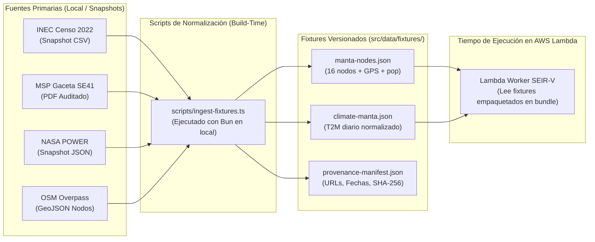

# Plan de Fuentes Primarias, Procedencia y Fixtures de Datos

> **Proyecto:** Spookython AWS — Track B: Operación Manta Cero.  
> **Área Geográfica:** Cantón Manta (Provincia de Manabí, Ecuador).  
> **Compromiso Metodológico:** Honestidad intelectual estricta ante el jurado. Distinción diáfana entre datos observados oficiales, mallas de reanálisis satelital, proxies de transporte y parámetros lúdico-educativos del simulador.  
> **Regla de Ejecución:** Cero consultas a APIs externas en tiempo de simulación; todos los datos se empaquetan como fixtures inmutables preprocesados en build-time con sumas de verificación SHA-256. Prohibición total de datos nominales de pacientes (cero PII).

---

## 1. Matriz de Fuentes Primarias Verificadas

Cada dato incorporado al proyecto cuenta con un registro formal de trazabilidad y clasificación metodológica:

| Dimensión | Fuente Primaria Oficial | URL Verificada | Cobertura Territorial y Temporal | Licencia y Términos | Estado de Acceso | Clasificación Metodológica | Uso Específico en el Modelo |
| :--- | :--- | :--- | :--- | :--- | :--- | :--- | :--- |
| **Demografía Cantonal** | **INEC** (Censo de Población y Vivienda 2022) | `https://www.ecuadorencifras.gob.ec/censo-de-poblacion-y-vivienda/` | Cantón Manta (271.145 hab.). Corte censal oficial 2022. | Datos Abiertos Ecuador / Atribución Estatal INEC. | Portal accesible; scraping automatizado devuelve 403 WAF. Requiere snapshot manual auditado. | `[OBSERVADO OFICIAL]` | Asignación de población base $N_v$ por nodo y parroquia urbana. |
| **Vigilancia Epidemiológica** | **MSP** (Dirección Nacional de Vigilancia Epidemiológica) | `https://www.salud.gob.ec/gacetas-vectoriales-2026/`<br>`https://www.salud.gob.ec/wp-content/uploads/2026/10/ETV_Gaceta_41.pdf` | Provincia de Manabí / Distrito 13D02. Semanal (SE01 a SE41, corte 17/10/2026). | Información Pública Institucional del Estado ecuatoriano. | Boletines PDF oficiales disponibles en portal web. | `[OBSERVADO OFICIAL]` | Justificación del reservorio vectorial y estacionalidad del dengue. |
| **Capacidad Hospitalaria** | **INEC / MSP** (Registro de Camas y Egresos Hospitalarios) | `https://www.ecuadorencifras.gob.ec/camas-y-egresos-hospitalarios/`<br>`https://anda.inec.gob.ec/anda5/index.php/catalog/1151` | Cantón Manta. Anual (estadística consolidada 2024). | Creative Commons Atribución 4.0 (CC BY 4.0). | Archivos tabulares abiertos descargables (CSV/ODS). | `[OBSERVADO OFICIAL]` | Registro de capacidad instalada real (camas censables de segundo nivel). |
| **Climatología y Vector** | **NASA POWER API** (Global Energy Resources) | `https://power.larc.nasa.gov/docs/services/api/temporal/daily/` | Punto (-0.95, -80.71). Malla espacial 0.5° x 0.5°. Datos diarios. | Dominio Público (NASA Open Data Policy). | API REST pública operativa; formato JSON estructurado. | `[ESTIMADO EN MALLA]` | Modulación climática de temperatura ($T_{2M}$) y humedad en el vector. |
| **Climatología Local** | **INAMHI** (Red Hidrometeorológica Nacional) | `https://servicios.inamhi.gob.ec/aplicaciones-web/` | Estación Manta (M003 / Base Aérea). Registro histórico. | Datos Abiertos Ecuador. | Portal de servicios en línea descubierto; descarga batch pendiente. | `[OBSERVADO OFICIAL / PENDIENTE]` | Referencia de contraste cualitativo para validar los datos satelitales. |
| **Red Vial y Equipamientos** | **OpenStreetMap (OSM)** | `https://osmfoundation.org/wiki/Attribution_Guidelines` | Coordenadas exactas de vías y equipamientos urbanos en Manta. | Open Database License (ODbL) 1.0. Atribución obligatoria. | Consulta mediante Overpass API y extractos Geofabrik. | `[OBSERVADO OFICIAL / PROXY]` | Coordenadas reales de 16 nodos; flujos de viaje modelados como proxy. |

---

## 2. Advertencias Científicas y Aclaraciones para el Jurado

### 2.1 Umbral de Contingencia Hospitalaria ($H_{\max}$) vs. Camas Reales Desocupadas
* **Contexto Estructural:** Los anuarios estadísticos de recursos de salud del INEC y del MSP reportan camas instaladas a nivel cantonal como capacidad censable general. Sin embargo, dichos conteos representan infraestructura física instalada, no camas desocupadas disponibles para emergencias.
* **Aclaración del Modelo:** En el motor matemático ([`src/domain/types.ts`](file:///C:/Users/MSI/BRAVO/Documents/ProyectosGit-2026/Yo/SpookythonAWS/src/domain/types.ts)), el parámetro por defecto es `hospitalCapacity: 2500`. **Queda estrictamente prohibido afirmar que Manta cuenta con 2.500 camas hospitalarias desocupadas o pretender que dicho valor surge de un censo de camas clínicas disponibles**. Este valor representa un **umbral efectivo de saturación de contingencia municipal simulada** evaluado frente a la suma total de individuos sintomáticos activos ($\sum I_v(t)$). Dicho umbral simula la capacidad combinada de respuesta primaria, carpas de campaña, aislamiento ambulatorio y centros de salud tipo C antes de que se degrade la tasa de recuperación comunitaria $\gamma$. No se sustituye este valor por cifras hospitalarias parciales sin un modelo explícito de fracción de hospitalización y observación clínica.

### 2.2 Granularidad Epidemiológica y Límites del Boletín MSP
* Las Gacetas Vectoriales del MSP (como la Gaceta ETV SE41 con corte al 17/10/2026) reportan acumulados a nivel provincial y distrital. **No existe desagregación oficial pública a nivel de barrio o calle**.
* Los casos observados representan únicamente pacientes que acudieron al sistema formal de salud, no la totalidad de infecciones reales. Pretender calcular una tasa de transmisión diaria ($\beta$) exacta para cada manzana de Manta a partir de los PDFs distritales constituiría una falsificación metodológica. El modelo utiliza los boletines para constatar la circulación endémica del vector (*Aedes aegypti*) y mantener los rangos de contagio dentro de magnitudes epidemiológicas plausibles para un simulador de estrategia. Se reconoce con transparencia que la calibración epidemiológica formal queda diferida.

### 2.3 Modelo de Clima en Malla vs. Sensores Urbanos
* La API NASA POWER proporciona estimaciones basadas en el modelo de asimilación MERRA-2 en celdas de 0.5° (~55 km). Refleja adecuadamente las tendencias térmicas generales de la costa de Manabí (24°C - 28°C), pero no captura microclimas barriales ni focos de agua estancada intradomiciliarios.

---

## 3. Taxonomía de Certeza de Datos

Para que el jurado y los revisores comprendan la naturaleza de cada dato visualizado en la plataforma, todo artefacto de datos incorpora una etiqueta explícita de certeza:

```
[OBSERVADO OFICIAL]
  │── Población cantonal censal INEC 2022 (271.145 hab.)
  │── Estadísticas estructurales agregadas de camas (INEC / MSP)
  │── Incidencia provincial agregada en Gaceta MSP SE41
  └── Geometría de ejes viales principales y coordenadas GPS de nodos (OSM)

[ESTIMADO EN MALLA]
  └── Series temporales de temperatura y precipitación satelital (NASA POWER MERRA-2)

[PROXY NO CALIBRADO / ESTIMACIÓN ESTRUCTURAL]
  │── Población asignada a los 16 nodos urbanos (264.281 hab., 97.5% de cobertura)
  └── Matriz de movilidad y conectividad entre barrios en función de la jerarquía vial

[PARÁMETRO EDUCATIVO DE SIMULACIÓN]
  │── Umbral de colapso de contingencia hospitalaria municipal (H_max = 2.500 casos sintomáticos simultáneos)
  │── Presupuesto diario asignado a intervenciones ($1.000 USD/día)
  └── Costos unitarios de vacunas ($200 por lote de 500 dosis), fumigación ($250) y cordones ($300)
```

---

## 4. Pipeline de Ingestión y Fixtures Inmutables

Para garantizar que el backend en AWS Lambda sea 100% determinista, ultra-rápido y no dependa de conexiones externas inestables, los datos se compilan localmente y se versionan como fixtures JSON:



### 4.1 Ubicación y Contratos de Archivos de Fixtures

1. `src/data/fixtures/manta-nodes.json`:  
   Contiene el arreglo de 16 nodos urbanos con `id`, `name`, `lat`, `lng`, `population`, `baseVectorRisk`, `betweenness` y `capacityProxy`.
2. `src/data/fixtures/climate-manta.json`:  
   Serie diaria de 60 días con factores multiplicadores vectoriales normalizados a partir de la temperatura y lluvia de NASA POWER.
3. `src/data/fixtures/provenance-manifest.json`:  
   Manifiesto formal de procedencia con hash SHA-256 de cada archivo, fecha de captura, entidad emisora y clasificación metodológica.

### 4.2 Script de Ingestión Planificado (`scripts/ingest-fixtures.ts`)

```typescript
// Script futuro a crear en la Tarea 03
// Lee snapshots estáticos locales, valida esquemas Zod, calcula SHA-256 y emite fixtures
import { createHash } from 'node:crypto';
import { writeFileSync, readFileSync } from 'node:fs';

export interface DataProvenanceManifest {
  version: string;
  generatedAt: string;
  sources: Array<{
    dimension: string;
    authority: string;
    sourceUrl: string;
    captureDate: string;
    methodologicalCategory: 'OBSERVED_OFFICIAL' | 'GRIDDED_ESTIMATE' | 'UNCALIBRATED_STRUCTURAL_PROXY' | 'SIMULATION_PARAMETER';
    fileSha256: string;
    notes: string;
  }>;
}
```

---

## 5. Estrategia de Validación y Pruebas de Calidad

* **Pruebas de Invarianza Poblacional:** La suma de poblaciones asignadas a los nodos de Manta en el fixture debe coincidir estrictamente con el grafo (`sum(N_v) == 264.281 hab.`), representando el 97,5% del cantón oficial (271.145 hab.) y excluyendo duplicidades.
* **Prueba de Ausencia de PII:** Suite automatizada que escanea todos los fixtures buscando patrones de nombres propios, cédulas de identidad, números telefónicos o registros clínicos individuales.
* **Prueba de Determinismo de Carga:** El bundle compilado de Lambda debe importar los fixtures en memoria de forma sincrónica con latencia `< 5 ms` y cero llamadas de red salientes.
