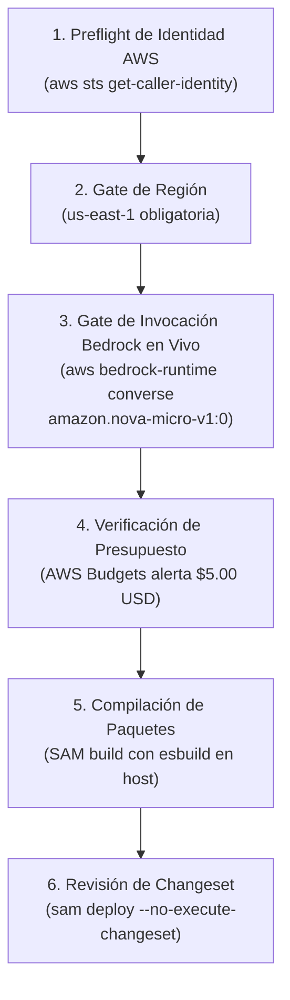

# Guía de Despliegue en AWS, Preflight Checks y Operación en Orca

> **Estado:** Documento Operativo de Despliegue y Orquestación Multi-Agente (Planificación de Referencia).  
> **Ámbito de Aplicación:** Infraestructura AWS Serverless (`us-east-1`), integración estática frontend/backend y procedimientos de ejecución mediante Orca CLI.  
> **Advertencia de Entorno:** Los binarios de CLI de AWS (`aws`) y AWS SAM (`sam`) **no se encuentran instalados en el PATH local del entorno actual**. Todos los comandos de compilación SAM, creación de ChangeSets y despliegue en la nube están documentados como **planes operativos para su ejecución futura** una vez configuradas las credenciales y el toolchain de nube.  
> **Advertencia de Seguridad:** Queda estrictamente prohibida la ejecución ciega de scripts destructivos o la eliminación global de recursos en la cuenta AWS (`aws delete ...` global). Toda limpieza o modificación de recursos requiere confirmación humana explícita.

---

## 1. Verificación Previa al Despliegue (Preflight Checks)

Antes de ejecutar cualquier comando de despliegue en la nube cuando se habiliten las credenciales, el operador humano o el agente responsable debe validar los siguientes requisitos indispensables:



### 1.1 Checklist de Comandos de Preflight (Futuros en Nube)

```bash
# 1. Comprobar identidad de la cuenta y permisos de rol activo
aws sts get-caller-identity --output table

# 2. Verificar que la región de destino sea us-east-1
aws configure get region

# 3. Gate Real de Invocación de Bedrock Nova Micro (Data-Plane Probe):
# NOTA: get-foundation-model solo valida metadatos de catálogo. Se requiere una invocación
# acotada en vivo mediante Converse API para certificar permisos reales de ejecución.
aws bedrock-runtime converse \
  --model-id amazon.nova-micro-v1:0 \
  --region us-east-1 \
  --messages '[{"role":"user","content":[{"text":"ping"}]}]' \
  --inference-config '{"maxTokens":5,"temperature":0}' \
  --query "output.message.content[0].text" --output text

# 4. Validar que la plantilla SAM sea sintácticamente correcta
sam validate --template-file infra/template.yaml

# 5. Ejecutar suite de pruebas locales previas en el motor de TypeScript
bun test
```

*Nota sobre el Gate de Bedrock:* Si la invocación de prueba de `converse` devuelve `AccessDeniedException`, `ResourceNotFoundException`, throttling o la cuenta carece de suscripción activa para Nova Micro, el parámetro de despliegue debe configurarse como `ENABLE_BEDROCK_AI=false`. El sistema operará con normalidad ejecutando las 3 estrategias base y fallback determinista sin bloquear el pitch.

---

## 2. Comandos de Construcción y Despliegue con AWS SAM

### 2.1 Construcción con Empaquetado Optimizado (Node.js 22 ARM64 en Host)

La plantilla SAM utiliza la propiedad `Metadata: BuildMethod: esbuild` para empaquetar cada handler Lambda de forma aislada, incluyendo únicamente las dependencias de producción y el AWS SDK v3 necesario. Se omite cualquier bandera no verificada como `--use-container=false` para compilar directamente sobre el host:

```bash
# Construir los artefactos en el directorio .aws-sam mediante esbuild
sam build --template-file infra/template.yaml
```

### 2.2 Despliegue Seguro con Revisión de ChangeSet y Ejecución por ARN

Para evitar discrepancias entre lo revisado y lo aplicado, se prohíbe relanzar `sam deploy` para ejecutar el despliegue. Se sigue el protocolo de ChangeSets de CloudFormation:

```bash
# 1. Generar el ChangeSet sin aplicarlo inmediatamente
sam deploy \
  --stack-name spookython-backend-demo \
  --region us-east-1 \
  --capabilities CAPABILITY_IAM \
  --no-execute-changeset \
  --resolve-s3

# 2. Obtener el ARN exacto del ChangeSet generado e inspeccionar los cambios
CHANGESET_ARN=$(aws cloudformation list-change-sets \
  --stack-name spookython-backend-demo \
  --region us-east-1 \
  --query "Summaries[0].ChangeSetId" --output text)

aws cloudformation describe-change-set \
  --change-set-name "$CHANGESET_ARN" \
  --region us-east-1

# 3. Tras confirmación humana explícita, APLICAR exactamente el ChangeSet auditado
aws cloudformation execute-change-set \
  --change-set-name "$CHANGESET_ARN" \
  --region us-east-1

# 4. Esperar a que el despliegue concluya satisfactoriamente
aws cloudformation wait stack-update-complete \
  --stack-name spookython-backend-demo \
  --region us-east-1
```

---

## 3. Integración con el Frontend Estático

Para el pitch de 5 minutos, la interfaz de usuario React se sirve desde una distribución de Amazon CloudFront respaldada por un bucket privado S3 para assets estáticos, mientras que la API backend se consume bajo el mismo origen:

```mermaid
flowchart LR
    Browser["Navegador Web"]
    
    subgraph CloudFront ["Amazon CloudFront (Mismo Origen)"]
        Router{"Enrutador de Path"}
        S3Static["Origen 1: S3 Bucket Estático\n(HTML, CSS, JS, MapLibre)\nAutenticado con OAC"]
        APIGW["Origen 2: API Gateway HTTP API\n(/api/v1/*)\nStage Path: $default"]
    end

    Browser -->|Petición HTTPS| Router
    Router -->|/* (Default Cache)| S3Static
    Router -->|/api/v1/* (No Cache + Forward All Except Host)| APIGW
```

### Reglas Críticas de Integración:
1. **Mismo Origen (`Same-Origin`) para Cookies de Sesión:** Al enrutar `/api/v1/*` a través del mismo CloudFront que aloja la SPA, las cookies `HttpOnly; Secure; SameSite=Strict` funcionan sin requerir configuraciones complejas de CORS ni arriesgar el bloqueo de cookies de terceros en el navegador del jurado.
2. **Cero Caché en API y Reenvío de Cabeceras:** El comportamiento de CloudFront para `/api/v1/*`:
   * `CachePolicyId: 4135ea2d-6da8-44a3-9e09-b5ba524b917d` (Managed-CachingDisabled).
   * `OriginRequestPolicyId`: `b689b0a8-53d0-40ab-baf2-68738e2966ac` (`Managed-AllViewerExceptHostHeader`) para preservar encabezados `Origin`, `Authorization`, `Idempotency-Key` y cookies `Set-Cookie` / `Cookie` reenviadas sin colisionar con el host de API Gateway.
   * La ruta de origen apunta al stage correcto de HTTP API (`$default`).
   * No se configuran páginas de error SPA personalizadas (ej. rewrite de 404 a `index.html`) para rutas `/api/*`.
3. **Bucket de Resultados NUNCA Público:** El bucket S3 que almacena los resultados pesados de las simulaciones (`spookython-backend-results-*`) **no es origen de CloudFront ni tiene URLs presignadas públicas**. Las descargas se realizan a través de la función Lambda autenticada en `/api/v1/jobs/{id}/results`.

---

## 4. Procedimiento de Pruebas de Humo (Smoke Tests) en la Nube

Una vez completado el despliegue futuro en AWS, se ejecuta el siguiente guion de validación funcional:

1. **Crear Dos Invitaciones Distintas:**
   ```bash
   bun run scripts/admin-invitations.ts create --label "Jurado 1"
   bun run scripts/admin-invitations.ts create --label "Jurado 2"
   ```
2. **Autenticación e Inicio de Sesión:**
   * Iniciar sesión en el navegador A con el código del Jurado 1. Verificar cookie `spk_session`.
   * Iniciar sesión en el navegador B con el código del Jurado 2.
3. **Lanzar Simulación Asíncrona:**
   * Jurado 1 envía `POST /api/v1/jobs` con visibilidad `PRIVATE` y encabezado `Idempotency-Key`.
   * Verificar respuesta `202 Accepted` con `jobId`.
4. **Verificar Aislamiento de Privacidad:**
   * Jurado 2 intenta consultar `GET /api/v1/jobs/{jobId-Jurado-1}`.
   * La API debe responder con `404 Not Found` (aislamiento estricto, sin filtrar existencia).
5. **Conmutar a Compartido y Recuperar Resultados:**
   * Jurado 1 envía `PATCH /api/v1/jobs/{id}/visibility` con `SHARED_INVITEES`.
   * Jurado 2 ahora puede consultar `GET /api/v1/jobs/shared` y descargar el resultado final vía `GET /results` tras re-verificación fuerte en base de datos.
6. **Verificar Deduplicación por Idempotencia:**
   * Repetir el envío idéntico con el mismo encabezado `Idempotency-Key`.
   * La API responde con el mismo `jobId` sin consumir cuota adicional ni relanzar Step Functions.
7. **Verificar Revocación y Expiración:**
   * Revocar la invitación del Jurado 2 mediante el CLI admin (`revoke`).
   * La siguiente petición de Jurado 2 con su cookie de sesión activa es rechazada de inmediato con `401 Unauthorized`.
8. **Verificar Ejecución Real de Bedrock vs Fallback:**
   * Si `ENABLE_BEDROCK_AI=true`, verificar que `aiSummary` contiene la política generada por Nova Micro (`aiProvenance.status === 'INVOKED'`). Si está deshabilitado o throttled, verificar que responde con `aiProvenance.status === 'FALLBACK_DETERMINISTIC'` sin fallar el job.

---

## 5. Procedimiento de Limpieza y Teardown Seguro

Para evitar costos residuales tras la demostración, el retiro de recursos debe resolver los nombres exactos desde los Outputs del Stack en lugar de especulaciones por prefijo:

```bash
# 1. Resolver el nombre exacto del bucket de resultados desde CloudFormation
RESULTS_BUCKET=$(aws cloudformation describe-stacks \
  --stack-name spookython-backend-demo \
  --region us-east-1 \
  --query "Stacks[0].Outputs[?OutputKey=='ResultsBucketName'].OutputValue" --output text)

# 2. Vaciar el bucket privado de resultados de simulación con confirmación explícita
if [ -n "$RESULTS_BUCKET" ] && [ "$RESULTS_BUCKET" != "None" ]; then
  aws s3 rm "s3://${RESULTS_BUCKET}" --recursive
fi

# 3. Eliminar el CloudFormation Stack del backend
aws cloudformation delete-stack --stack-name spookython-backend-demo --region us-east-1

# 4. Verificar la eliminación completa de los recursos
aws cloudformation wait stack-delete-complete --stack-name spookython-backend-demo --region us-east-1
```

*Prohibición Expresa:* Nunca ejecutar comandos de borrado masivo sin filtro de nombres (como scripts automáticos que eliminen tablas o buckets no asociados al stack auditado).

---

## 6. Operación y Ciclo de Vida Multi-Agente en Orca

Durante las fases de desarrollo asistidas por agentes en la plataforma **Orca Multi-Agent IDE**, se aplican los siguientes protocolos de coordinación:

### 6.1 Identificadores de Procedencia de la Planificación Actual
* **Run ID:** `run_d75462ffccbb`
* **Dispatch ID:** `ctx_2692a52289c2`
* **Task ID:** `task_e13ca20af50f`
* **Terminal del Coordinador:** `term_c5a06209-5e94-4f5f-8952-09a9c442b007`
* **Terminal del Worker de Documentación:** `term_7cc86999-9de5-4452-aac5-58f55d5f1938`
* **Modelo en Uso Verificado:** Gemini 3.8 Flash (Medium). No alternar modelos ni proveedores durante la tarea.

### 6.2 Reglas de Ejecución para Futuras Olas de Agentes
1. **Un Solo Agente Escritor por Árbol de Código Compartido:**  
   Para prevenir conflictos de git y sobrescrituras destructivas, **solo un agente a la vez tiene autorización de escritura** en el código fuente. Los agentes de investigación y análisis operan en modo solo lectura (`read-only`) o en árboles de trabajo aislados (`git worktree`).
2. **Plantilla de Despacho de Tareas para el Coordinador:**  
   Para iniciar un worker especializado a partir de una ficha de tarea (`task brief`), el coordinador ejecuta:
   ```powershell
   Get-Content -Raw docs/backend-demo/agents/01-contracts.md | orca orchestration worker-start --spec -
   ```
3. **Ciclo de Revisión Nativa y Recibos con Gentle AI:**  
   Antes de confirmar cualquier cambio en git (`pre-commit`), el agente ejecutor sigue el ciclo de autoridad nativo sin lanzar revisiones extemporáneas en el gate:
   1. Iniciar revisión: `gentle-ai review start` (descubre el target y fija el presupuesto de corrección).
   2. Consolidar resultados: `gentle-ai review finalize --result <archivo>`.
   3. Hacer staging de los archivos revisados sin alterar contenido: `git add <rutas>`.
   4. Validar el recibo bound: `gentle-ai review validate --gate pre-commit --cwd .`.
4. **Comandos Estándar de Comunicación del Worker en Orca (Conforme a Ayuda del Binario):**
   * **Heartbeat periódico (cada 5 minutos):**
     ```bash
     orca orchestration send --from <TERMINAL_ID> --type heartbeat --subject "alive" --task-id <TASK_ID> --dispatch-id <DISPATCH_ID> --phase "<investigating|implementing|reviewing|waiting>"
     ```
   * **Lectura de Mensajes del Coordinador (al inicio de cada archivo y tras pruebas):**
     ```bash
     orca orchestration check --terminal <TERMINAL_ID> --json
     ```
   * **Consulta Bloqueante al Coordinador (opciones CSV soportadas por el CLI):**
     ```bash
     orca orchestration ask --from <TERMINAL_ID> --question "¿Pregunta técnica concreta?" --options "OpciónA,OpciónB" --timeout-ms 600000
     ```
   * **Cierre de Tarea (Exactamente una vez):**
     ```bash
     orca orchestration send --from <TERMINAL_ID> --type worker_done --subject "<short status>" --body "<3-sentence executive summary>" --task-id <TASK_ID> --dispatch-id <DISPATCH_ID> --outcome succeeded --report-path <PATH> --files-modified "<FILES>"
     ```
