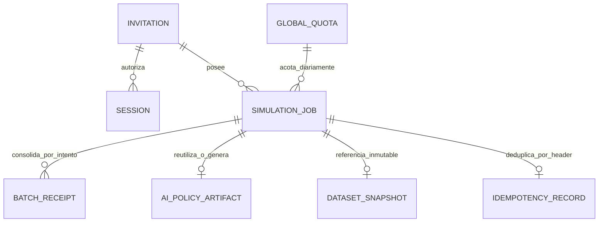
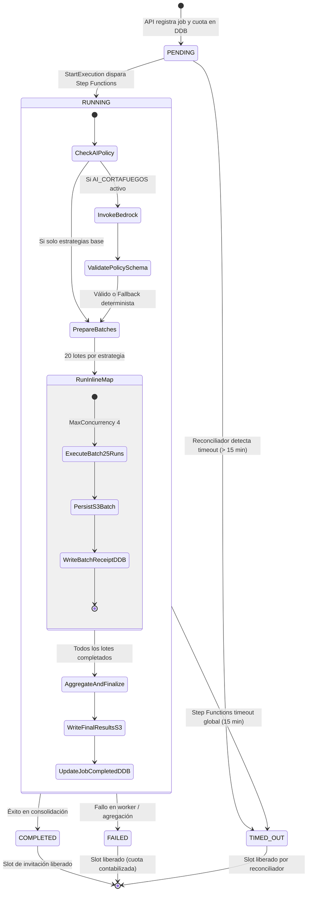
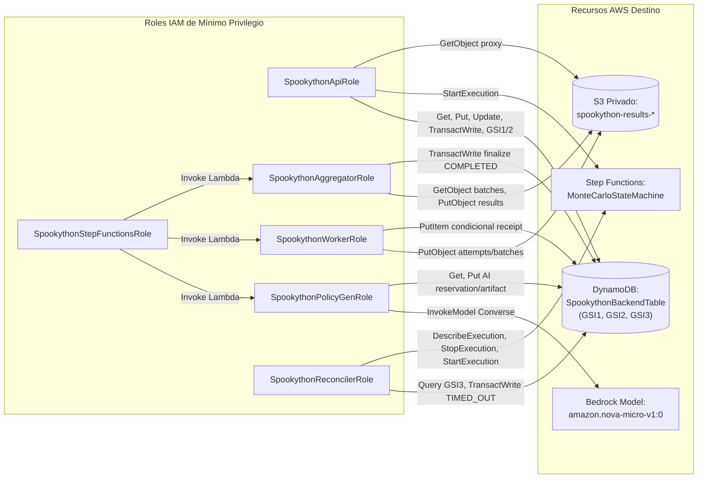

# Especificación de Diseño Técnico — Arquitectura Backend Serverless

> **Estado:** Documento de Diseño Técnico de Referencia (Markdown Design).  
> **Propósito:** Definición formal de modelos de datos, patrones de acceso en DynamoDB, máquina de estados, contratos de API REST v1, integración con Bedrock e inventario de infraestructura con roles IAM de mínimo privilegio.  
> **Nota de Gobernanza:** Este documento no inventa esquemas OpenAPI prematuros ni asume dependencias externas complejas. La primera tarea de implementación generará los esquemas formales en Zod y derivará el contrato OpenAPI 3.1.

---

## 1. Modelo de Datos Lógico y Entidades

Se define un esquema de **Tabla Única en Amazon DynamoDB** (`SpookythonBackendTable`) configurada en modo `PAY_PER_REQUEST` con claves genéricas `PK` (Partition Key, String) y `SK` (Sort Key, String), complementada con tres Índices Secundarios Globales (`GSI1`, `GSI2` y `GSI3` disperso para reconciliación) para satisfacer todos los patrones de consulta requeridos por el ciclo de vida de la aplicación.



### 1.1 Entidades del Dominio y Esquema de Claves Canónicas

| Entidad | `PK` | `SK` | Atributos Clave e Invariantes |
| :--- | :--- | :--- | :--- |
| **Invitation** | `INV#<invitationId>` | `METADATA` | `invitationId`: UUID v4 canónico.<br>`codeHash`: SHA-256 del código de alta entropía (>=128 bits criptográficos, 26-32 caracteres Base32/hex).<br>`label`: Nombre descriptivo (ej. "Jurado Track B").<br>`maxJobsPerDay`: Límite diario (defecto 20).<br>`status`: `'ACTIVE' \| 'REVOKED' \| 'EXPIRED'`.<br>`createdAt`: ISO 8601.<br>`expiresAt`: ISO 8601 (máximo 7 días desde creación).<br>`activeJobsCount`: Entero (invariante: `0 <= activeJobsCount <= 1`).<br>`ttl`: Epoch timestamp (`createdAt + 7 días`). |
| **InvitationCodeLookup** | `CODE#<codeHash>` | `RESOLVE` | Puntero determinista para autenticación O(1):<br>`codeHash`: SHA-256 del código.<br>`invitationId`: Puntero canónico al registro `INV#<invitationId>`.<br>`ttl`: Epoch timestamp sincronizado con la invitación. |
| **Session** | `SES#<hash(token)>` | `METADATA` | `tokenHash`: SHA-256 del token opaco de sesión (>=256 bits criptográficos, 64 hex chars).<br>`sessionId`: UUID v4.<br>`invitationId`: Puntero a la invitación origen.<br>`invitationKey`: `INV#<invitationId>` canónico para transacciones atómicas.<br>`createdAt`: ISO 8601.<br>`expiresAt`: ISO 8601 (mínimo entre `createdAt + 12h` y la expiración de la invitación).<br>`ttl`: Epoch timestamp de expiración de sesión. |
| **SimulationJob** | `JOB#<jobId>` | `METADATA` | `jobId`: UUID v4.<br>`invitationId`: Identificador del propietario.<br>`invitationKey`: `INV#<invitationId>` resuelto para transacciones de admisión/liberación.<br>`status`: `'PENDING' \| 'RUNNING' \| 'COMPLETED' \| 'FAILED' \| 'TIMED_OUT'`.<br>`slotReleased`: Boolean (invariante de liberación atómica: inicia en `false`, solo transiciona a `true` al decrementar slot).<br>`attempt`: Entero (inicia en 1; cualquier reintento o nueva ejecución incrementa para fencing).<br>`visibility`: `'PRIVATE' \| 'SHARED_INVITEES'`.<br>`canonicalInput`: JSON string ordenado de la petición para Step Functions.<br>`scenarioParams`: Parámetros de simulación validados (17 campos exactos).<br>`strategies`: Arreglo de estrategias (ej. `['NO_INTERVENTION', 'RANDOM', 'SMART_CORTAFUEGOS']` o con `AI_CORTAFUEGOS`).<br>`runsPerStrategy`: 500 (fijo en servidor).<br>`totalRuns`: 1.500 (base) o 2.000 (con IA).<br>`stepFunctionExecutionArn`: ARN determinista (`manta-sim-${jobId}-${attempt}`).<br>`s3ResultsKey`: Ruta en bucket privado S3 (`jobs/<jobId>/attempts/<attempt>/results.json`).<br>`createdAt`: ISO 8601.<br>`dueTimeIso`: ISO 8601 (`createdAt + 15 min`, límite de timeout).<br>`GSI3PK`: `STATUS#<status>` (proyectado solo mientras `status IN ('PENDING', 'RUNNING')`).<br>`GSI3SK`: `<dueTimeIso>` (clave de ordenamiento de vencimiento).<br>`completedAt`: ISO 8601 (opcional).<br>`ttl`: Epoch timestamp (`createdAt + 7 días`). |
| **DatasetSnapshot** | `DATASET#<version>` | `METADATA` | `version`: Identificador inmutable (ej. `v2026.10-manta-census`).<br>`manifestHash`: SHA-256 del manifiesto de procedencia.<br>`nodeCount`: 16.<br>`totalPopulation`: 264.281 hab.<br>`provenanceSummary`: Resumen de fuentes (INEC, MSP, NASA POWER, OSM).<br>`publishedAt`: ISO 8601.<br>`ttl`: Epoch timestamp (`publishedAt + 7 días`). |
| **BatchReceipt** | `JOB#<jobId>` | `ATTEMPT#<attempt>#BATCH#<strategy>#<batchIndex>` | `strategy`: Identificador de la estrategia.<br>`attempt`: Número de intento (fencing estricto).<br>`batchIndex`: Índice de lote (`0..19` para 500 corridas en lotes de 25).<br>`startRunIndex`: Primer índice global del lote.<br>`endRunIndex`: Último índice del lote.<br>`runsCount`: 25.<br>`s3BatchKey`: Clave inmutable en S3 (`jobs/<jobId>/attempts/<attempt>/batches/<strategy>_<batchIndex>.json.gz`).<br>`checksum`: SHA-256 del payload de lote.<br>`processedAt`: ISO 8601. |
| **Idempotency** | `IDEMP#<invitationId>#<hash(Idempotency-Key)>` | `RECORD` | `jobId`: Identificador del trabajo registrado.<br>`payloadHash`: Hash SHA-256 del JSON canónico de parámetros (permite detectar `409 Conflict` si el payload difiere).<br>`status`: Estado del job.<br>`createdAt`: ISO 8601.<br>`ttl`: Epoch timestamp (`createdAt + 7 días`, retenido al menos durante el período de acceso al job). |
| **GlobalDailyQuota** | `GLOBAL_QUOTA#<YYYY-MM-DD>` | `COUNTER` | `jobCount`: Número global de trabajos aceptados hoy (máximo 100).<br>`date`: Cadena `YYYY-MM-DD`.<br>`ttl`: Epoch timestamp (`fin de día + 48h`). |
| **DailyQuota** | `QUOTA#<invitationId>#<YYYY-MM-DD>` | `COUNTER` | `jobCount`: Número de trabajos aceptados hoy para esta invitación (máximo 20).<br>`invitationId`: Puntero a la invitación.<br>`ttl`: Epoch timestamp (`fin de día + 48h`). |
| **AIPolicyArtifact** | `AIPOLICY#<cacheKey>` | `ARTIFACT` | `cacheKey`: `hash(datasetVersion + promptVersion + modelId + sanitizedParamsHash)` (aislado por propietario si incluye datos contextuales privados; compartido solo para parámetros públicos e inmutables).<br>`policySpec`: Objeto JSON validado de la política declarativa.<br>`modelId`: `amazon.nova-micro-v1:0`.<br>`usage`: Tokens de entrada y salida.<br>`createdAt`: ISO 8601.<br>`ttl`: Epoch timestamp (`createdAt + 7 días`). |
| **AIReservation** | `JOB#<jobId>` | `AI_ATTEMPT#<attemptNum>` | Registro transaccional previo a la invocación de Bedrock:<br>`attemptNum`: 1 o 2 (presupuesto máximo de 2 intentos totales por job).<br>`reservedAt`: ISO 8601.<br>`status`: `'RESERVED' \| 'INVOKED' \| 'FAILED'`. Evita superar el límite de llamadas ante fallos o reintentos no controlados. |

---

## 2. Índices Secundarios Globales y Patrones de Acceso

### 2.1 Definición de Índices

* **GSI1 (Consultas de Trabajos Propios por Invitación y Fecha):**
  * `GSI1PK`: `INV#<invitationId>`
  * `GSI1SK`: `STATUS#<status>#CREATED#<createdAt>`
  * *Proyección:* `ALL` (permite a `GET /api/v1/jobs` listar trabajos propios ordenados cronológicamente sin lecturas adicionales a la tabla base).
* **GSI2 (Visibilidad Compartida y Trabajos Globales):**
  * `GSI2PK`: `VISIBILITY#<visibility>` (ej. `VISIBILITY#SHARED_INVITEES`)
  * `GSI2SK`: `CREATED#<createdAt>`
  * *Proyección:* `INCLUDE` (`jobId`, `invitationId`, `status`, `createdAt`, `strategies`, `totalRuns`, `s3ResultsKey`, `expiresAt`).
  * *Protocolo de Verificación Fuerte:* Debido a la consistencia eventual de los GSIs, cualquier candidato recuperado vía `GSI2` para `GET /api/v1/jobs/shared` **debe ser re-verificado mediante un `GetItem` consistente en la tabla base** antes de divulgar información al cliente, asegurando que `visibility == 'SHARED_INVITEES'`, que el trabajo no haya expirado (`expiresAt > NOW()`) y que la invitación propietaria no esté revocada.
* **GSI3 (Índice Disperso para Reconciliación de Trabajos Activos y Huérfanos):**
  * `GSI3PK`: `STATUS#<status>` (proyectado exclusivamente para `STATUS#PENDING` y `STATUS#RUNNING`).
  * `GSI3SK`: `<dueTimeIso>` (marca temporal ISO calculada al crear el job como `createdAt + 15 min`).
  * *Proyección:* `INCLUDE` (`jobId`, `invitationId`, `invitationKey`, `attempt`, `stepFunctionExecutionArn`, `createdAt`, `dueTimeIso`).
  * *Mantenimiento de Dispersión:* Al alcanzar un estado terminal (`COMPLETED`, `FAILED`, `TIMED_OUT`), la transacción atómica elimina los atributos `GSI3PK` y `GSI3SK` del ítem base, removiéndolo automáticamente del índice y garantizando que el `GSI3` contenga únicamente trabajos en vuelo.
  * *Paginación:* El Reconciliador ejecuta `Query` sobre `GSI3PK = STATUS#PENDING` y `GSI3PK = STATUS#RUNNING` con condición `dueTimeIso <= NOW()`, paginando si `LastEvaluatedKey` está presente.

### 2.2 Matriz de Patrones de Acceso a Datos

| ID | Patrón de Acceso | Operación DynamoDB | Claves / Condición |
| :--- | :--- | :--- | :--- |
| **PA-01** | Autenticar código de invitación | `GetItem` en tabla base (doble lookup seguro) | Paso 1: `GetItem(PK = CODE#<codeHash>, SK = RESOLVE)`.<br>Paso 2: `GetItem(PK = INV#<invitationId>, SK = METADATA)`.<br>Verifica en tiempo constante que `status == 'ACTIVE'` y `expiresAt > NOW()`. Respuestas de error uniformes (401 opaco) para no filtrar si el código es inexistente, revocado o expirado. |
| **PA-02** | Validar sesión e invitación en cada petición | `GetItem` en tabla base | `GetItem(PK = SES#<hash(token)>, SK = METADATA)`. Valida `expiresAt > NOW()`. Seguidamente valida que `INV#<invitationId>` tenga `status == 'ACTIVE'` y no esté expirada. Ambas validaciones son obligatorias en cada endpoint protegido (cero caché de autorización que retrase revocaciones). |
| **PA-03** | Admisión atómica de nuevo trabajo | `TransactWriteItems` (5 operaciones atómicas) | **Pre-chequeo Idempotencia:** Si `GetItem(PK = IDEMP#<invitationId>#<hash(Idempotency-Key)>)` existe y su `payloadHash` coincide, responde inmediatamente con el `jobId` existente sin consumir cuota ni slots.<br>Si el `payloadHash` difiere, rechaza con `409 Conflict`.<br>Si no existe, ejecuta `TransactWriteItems`:<br>1. `UpdateItem` en `GLOBAL_QUOTA#<YYYY-MM-DD>` incrementando `jobCount` con condición `jobCount < 100`.<br>2. `UpdateItem` en `QUOTA#<invitationId>#<YYYY-MM-DD>` incrementando `jobCount` con condición `jobCount < 20`.<br>3. `UpdateItem` en `INV#<invitationId>` incrementando `activeJobsCount` con condición `activeJobsCount < 1 AND status = 'ACTIVE' AND expiresAt > :now`.<br>4. `PutItem` en `JOB#<jobId>` con `slotReleased = false`, `attempt = 1`, `status = 'PENDING'`, `dueTimeIso = createdAt + 15 min`, y proyección `GSI3`.<br>5. `PutItem` en `IDEMP#<invitationId>#<hash(Idempotency-Key)>` guardando `payloadHash` y `jobId` con TTL de 7 días. |
| **PA-04** | Consultar trabajos propios paginados | `Query` sobre `GSI1` | Endpoint `GET /api/v1/jobs`. `GSI1PK = INV#<invitationId>`, orden descendente por `GSI1SK`. Retorna lista de jobs creados por la invitación autenticada. |
| **PA-05** | Consultar galería compartida | `Query` sobre `GSI2` + Verificación Fuerte | Endpoint `GET /api/v1/jobs/shared`. `GSI2PK = VISIBILITY#SHARED_INVITEES`, orden descendente por `GSI2SK`. Cada ítem candidato se valida fuertemente contra la tabla base antes de exponerlo. |
| **PA-06** | Finalización exactly-once y liberación de slot | `TransactWriteItems` condicional | **Operación 1:** `UpdateItem` en `JOB#<jobId>` con condición `slotReleased = false AND attempt = :att AND #st IN ('PENDING', 'RUNNING')`. Asigna `slotReleased = true`, `status = 'COMPLETED'` (o `FAILED`), `s3ResultsKey = ...`, y remueve `GSI3PK`/`GSI3SK`.<br>**Operación 2:** `UpdateItem` en `INV#<invitationId>` decrementando `activeJobsCount` con condición `activeJobsCount > 0`.<br>*Garantía:* Si un worker tardío o un reintento intenta finalizar un job ya cerrado o de un intento anterior, la condición falla atómicamente y no libera el slot de un trabajo posterior. |
| **PA-07** | Registro idempotente de lote de corrida | `PutItem` condicional con fencing | `PK = JOB#<jobId>`, `SK = ATTEMPT#<attempt>#BATCH#<strategy>#<batchIndex>`. Condición `attribute_not_exists(PK)`. Impide que retries de Step Functions dupliquen cómputo o sobrescriban lotes de intentos previos. |
| **PA-08** | Detección global de trabajos estancados/huérfanos | `Query` sobre `GSI3` disperso | Ejecutado por el Reconciliador: `GSI3PK = STATUS#PENDING` (y seguidamente `STATUS#RUNNING`) con filtro `dueTimeIso <= :now`. Escala eficientemente sin escaneo de particiones de invitación. |

---

## 3. Máquina de Estados del Trabajo y Recuperación de Fallos

El procesamiento distribuido se orquesta mediante **AWS Step Functions Standard Workflow** para garantizar trazabilidad exacta, historial de auditoría y evitar la pérdida de eventos.



### 3.1 Transiciones y Recuperación de Fallos

1. **Garantía de Liberación de Concurrencia (Exactly-Once Finalize):**  
   El slot `activeJobsCount` se decrementa **única y exclusivamente mediante la transacción condicional de finalización** (`TransactWriteItems`), la cual exige como condición que el job tenga `slotReleased = false AND attempt = :att AND status IN ('PENDING', 'RUNNING')`. Ni la Lambda `Aggregator` ni el `Reconciler` decrementan `activeJobsCount` con una condición simple `activeJobsCount > 0`, ya que esto causaría la liberación errónea del slot de un trabajo nuevo si una ejecución antigua se demora o falla tardíamente.
2. **Idempotencia de Arranque y Semántica de Step Functions:**  
   Según la especificación oficial de AWS Step Functions (`StartExecution`), la llamada es idempotente **únicamente si la ejecución con el mismo nombre (`name`) sigue en estado `RUNNING` y con idéntico payload de entrada**. Si la ejecución ya concluyó (`SUCCEEDED`, `FAILED`, `TIMED_OUT`), una invocación con el mismo nombre devuelve un error `ExecutionAlreadyExists`. Por este motivo, el sistema:
   * Persiste el `canonicalInput` en DynamoDB antes de invocar la máquina de estados.
   * Utiliza un ARN determinista indexado por intento: `manta-sim-${jobId}-${attempt}`.
   * Si la llamada a `StartExecution` devuelve un error de red incierto (timeout del cliente HTTP), el reconciliador inspecciona el estado antes de 15 minutos mediante `DescribeExecution` y reconcilia la ejecución sin duplicar lotes.
3. **Manejo de Errores en ASL (Sin Catch Global en Raíz):**  
   La especificación ASL (Amazon States Language) **no permite bloques `Catch` en el nivel raíz de la máquina de estados**. El manejo de errores se estructura así:
   * Bloques `Catch` específicos configurados en cada estado `Task` y en el estado `Map` de ejecución de lotes, redirigiendo a la Lambda de finalización con motivo de error.
   * El timeout global del workflow (15 minutos) y cualquier detención inesperada del orquestador son vigilados externamente por el **Reconciliador Programado**, que consulta el índice disperso `GSI3` y ejecuta la transacción de cierre forzado si el tiempo límite expira.
4. **Consolidación Estricta de Lotes y Fencing de Intentos:**  
   La Lambda `Aggregator` no confía en conteos parciales: antes de calcular las bandas P10/Media/P90, valida el **manifiesto completo de lotes** en S3 (`jobs/<jobId>/attempts/<attempt>/batches/<strategy>_<0..19>.json.gz`) verificando que existen los 20 archivos por estrategia (500 corridas en total). Si falta un lote, el job se marca como `FAILED` y no se emite un resultado corrupto.

---

## 4. Especificación de la API REST v1

### 4.1 Principios de Seguridad y Manejo de Rutas

* **Prefijo Canónico:** `/api/v1/*`.
* **Transporte Seguro:** Todas las cookies de autenticación se configuran con `HttpOnly; Secure; SameSite=Strict; Path=/api/v1`.
* **Alta Entropía Criptográfica:** Los códigos de invitación contienen >=128 bits de entropía criptográfica (26 a 32 caracteres Base32 legibles generados con CSPRNG). Los tokens de sesión contienen >=256 bits de entropía (32 bytes aleatorios criptográficos codificados en hexadecimal de 64 caracteres).
* **Protección contra Enumeración:** La autenticación en `/api/v1/auth/session` devuelve un error idéntico `401 Unauthorized` ("Invalid or expired invitation code") en tiempo constante ante códigos inexistentes, revocados o expirados.
* **Control de Tasa y Protección Perimetral:**
  * Rate limiter estricto en el endpoint de login (máximo 5 intentos/minuto por IP/subnet implementado vía token-bucket en DynamoDB o throttling en API Gateway).
  * Límite de tamaño de cuerpo de petición (request body cap) fijado en **64 KiB** en todas las mutaciones para prevenir ataques de denegación de servicio.
  * Verificación obligatoria de encabezados `Origin` y protección contra CSRF en peticiones con mutación.
  * Configuración CORS con lista blanca estricta de orígenes autorizados (ej. `http://localhost:5173`, `https://demo.example.com`) con `Access-Control-Allow-Credentials: true`. Queda **estrictamente prohibido el uso de comodín (`*`) junto con credenciales**.
* **Rechazo Temprano:** Cualquier ruta o método HTTP no reconocido es rechazado de inmediato con `404 Not Found` o `405 Method Not Allowed` en el manejador perimetral **antes de realizar operaciones de base de datos o cómputo**.
* **Retiro Estricto de Rutas Heredadas:** Las rutas legacy `/simulate` y `/mayor-report` del prototipo anterior son **eliminadas del enrutador público** o devuelven `410 Gone`. Queda estrictamente prohibido permitir bypass de cuota o autenticación mediante invocaciones a los endpoints antiguos.

### 4.2 Catálogo de Endpoints

#### 1. Iniciar Sesión con Invitación
* **Ruta:** `POST /api/v1/auth/session`
* **Autenticación:** Pública (sujeta a rate limiting perimetral).
* **Cuerpo de Petición:**
  ```json
  {
    "code": "SPK-4M7X-9W2K-8P3R-5Q6T-1V8B"
  }
  ```
* **Validación:** Formato de código regex de alta entropía (>=128 bits, ej. `^[A-Z2-7]{4}(-[A-Z2-7]{4}){5,7}$` o Base32/hex).
* **Respuesta Exitosa (200 OK):**
  * Encabezado: `Set-Cookie: spk_session=ses_<64_hex_chars>; HttpOnly; Secure; SameSite=Strict; Max-Age=43200; Path=/api/v1`
  * Cuerpo:
    ```json
    {
      "ok": true,
      "session": {
        "sessionId": "4a713912-32b1-4f9e-9d2a-19c83fa41092",
        "label": "Jurado Track B",
        "expiresAt": "2026-10-27T04:30:00.000Z",
        "maxJobsPerDay": 20,
        "remainingJobsToday": 19
      }
    }
    ```
* **Errores:** `400 Bad Request` (formato inválido), `401 Unauthorized` (genérico y constante para código inexistente, revocado o expirado), `429 Too Many Requests` (límite de intentos de login excedido).

#### 2. Cerrar Sesión
* **Ruta:** `DELETE /api/v1/auth/session`
* **Autenticación:** Sesión activa vía cookie.
* **Respuesta Exitosa (200 OK):** Invalida el token en DynamoDB y limpia la cookie con `Max-Age=0`.

#### 3. Crear Trabajo de Simulación
* **Ruta:** `POST /api/v1/jobs`
* **Autenticación:** Sesión activa vía cookie (valida token e invitación activa simultáneamente).
* **Encabezado Obligatorio:** `Idempotency-Key: <cadena-1-a-128-caracteres>`
* **Límite de Payload:** Máximo 64 KiB.
* **Cuerpo de Petición (17 Parámetros Exactos de `SimulationParams`):**
  ```json
  {
    "params": {
      "betaHuman": 0.35,
      "betaVector": 0.12,
      "sigma": 0.33,
      "gamma": 0.10,
      "hospitalCapacity": 2500,
      "vaccineEfficacy": 0.85,
      "dailyBudget": 1000,
      "vaccineCost": 200,
      "vaccineBatchSize": 500,
      "fumigationCost": 250,
      "cordonCost": 300,
      "days": 60,
      "seed": 20261030,
      "monteCarloRuns": 500,
      "patientZeroIds": ["N01"],
      "initialInfectedPerNode": 35,
      "initialExposedPerNode": 50
    },
    "enableAiStrategy": false,
    "visibility": "PRIVATE"
  }
  ```
* **Límites de Validación Numérica (Zod):**
  * `betaHuman`, `betaVector`: número flotante en `[0.01, 1.0]`.
  * `sigma`, `gamma`: número flotante en `[0.01, 1.0]`.
  * `hospitalCapacity`: entero en `[100, 10000]` (interpretado como umbral de saturación de contingencia frente a $\sum I_v(t)$).
  * `vaccineEfficacy`: número flotante en `[0.10, 1.0]`.
  * `dailyBudget`: entero en `[100, 10000]`.
  * `vaccineCost`, `vaccineBatchSize`, `fumigationCost`, `cordonCost`: enteros positivos en `[1, 5000]`.
  * `days`: entero en `[1, 60]` (rango estricto del modelo).
  * `seed`: entero de 32-bit sin signo (`[1, 4294967295]`).
  * `monteCarloRuns`: entero en `[10, 500]` (el servidor aplica 500 por estrategia en perfil de producción).
  * `patientZeroIds`: arreglo no vacío de strings pertenecientes a `N01`..`N16`.
  * `initialInfectedPerNode`, `initialExposedPerNode`: enteros en `[0, 500]`.
* **Respuesta Exitosa (202 Accepted):**
  ```json
  {
    "ok": true,
    "jobId": "8f1a2340-9a21-4f11-b924-817a02cba312",
    "status": "PENDING",
    "createdAt": "2026-10-26T16:35:00.000Z",
    "totalRuns": 1500,
    "strategies": ["NO_INTERVENTION", "RANDOM", "SMART_CORTAFUEGOS"],
    "checkUrl": "/api/v1/jobs/8f1a2340-9a21-4f11-b924-817a02cba312"
  }
  ```
* **Errores:** `400 Bad Request` (parámetros fuera de rango o encabezado `Idempotency-Key` ausente), `409 Conflict` (invitación ya tiene un trabajo activo en ejecución o colisión de clave de idempotencia con payload diferente), `429 Too Many Requests` (cuota diaria alcanzada: 20/invitación o 100 global).

#### 4. Consultar Lista de Trabajos Propios
* **Ruta:** `GET /api/v1/jobs`
* **Autenticación:** Sesión activa vía cookie.
* **Consulta:** Consulta directa sobre `GSI1` (`GSI1PK = INV#<invitationId>`) con paginación (`?cursor=...&limit=20`).
* **Respuesta Exitosa (200 OK):**
  ```json
  {
    "ok": true,
    "jobs": [
      {
        "jobId": "8f1a2340-9a21-4f11-b924-817a02cba312",
        "status": "COMPLETED",
        "visibility": "PRIVATE",
        "createdAt": "2026-10-26T16:35:00.000Z",
        "completedAt": "2026-10-26T16:35:38.000Z",
        "strategies": ["NO_INTERVENTION", "RANDOM", "SMART_CORTAFUEGOS"],
        "totalRuns": 1500
      }
    ],
    "nextCursor": null
  }
  ```

#### 5. Consultar Galería de Trabajos Compartidos
* **Ruta:** `GET /api/v1/jobs/shared`
* **Autenticación:** Sesión activa vía cookie.
* **Consulta:** Consulta sobre `GSI2` (`GSI2PK = VISIBILITY#SHARED_INVITEES`) con **re-verificación fuerte en la tabla base** de cada ítem antes de incluirlo en la respuesta para filtrar revocaciones o expiraciones en consistencia eventual.
* **Respuesta Exitosa (200 OK):** Lista de trabajos compartidos por otros invitados autorizados.

#### 6. Consultar Estado de un Trabajo Específico
* **Ruta:** `GET /api/v1/jobs/{id}`
* **Autenticación:** Sesión activa vía cookie.
* **Control de Acceso:** Permitido si el usuario es el propietario del trabajo o si el trabajo tiene `visibility == 'SHARED_INVITEES'`.
* **Respuesta Exitosa (200 OK):**
  ```json
  {
    "ok": true,
    "job": {
      "jobId": "8f1a2340-9a21-4f11-b924-817a02cba312",
      "status": "COMPLETED",
      "isOwner": true,
      "visibility": "PRIVATE",
      "createdAt": "2026-10-26T16:35:00.000Z",
      "completedAt": "2026-10-26T16:35:38.000Z",
      "executionDurationMs": 38200,
      "totalRuns": 1500,
      "strategies": ["NO_INTERVENTION", "RANDOM", "SMART_CORTAFUEGOS"],
      "hasResults": true,
      "resultsUrl": "/api/v1/jobs/8f1a2340-9a21-4f11-b924-817a02cba312/results"
    }
  }
  ```
* **Errores:** `404 Not Found` (job inexistente o privado perteneciente a otra invitación; previene filtración de metadatos).

#### 7. Obtener Resultados de la Simulación
* **Ruta:** `GET /api/v1/jobs/{id}/results`
* **Autenticación y Autorización:** Valida fuertemente en DynamoDB que el usuario sea el dueño o que el trabajo sea compartido y no esté expirado.
* **Mecanismo de Entrega:** El handler Lambda actúa como proxy seguro leyendo el resultado consolidado desde S3 privado (`jobs/<jobId>/attempts/<attempt>/results.json`) y transmitiéndolo con compresión `gzip`. Cero enlaces presignados públicos.
* **Endpoint de Trayectoria Dividida (Opcional ante Límite de Payload):** Si el resultado completo excede los límites seguros de payload HTTP (6 MB en Lambda/API Gateway), el sistema proporciona el endpoint especializado:
  `GET /api/v1/jobs/{id}/results/trajectory?strategy=NO_INTERVENTION` para transmitir la trayectoria detallada `run0` por separado de las bandas agregadas.
* **Estructura de Respuesta (Envoltura Versionada v2 - [Esquemático / Ilustrativo]):**
  > *Nota Metodológica:* Los valores numéricos mostrados a continuación son puramente ilustrativos para representar la estructura del esquema y no corresponden a datos epidemiológicos observados.
  ```json
  {
    "ok": true,
    "jobId": "8f1a2340-9a21-4f11-b924-817a02cba312",
    "computedAtIso": "2026-10-26T16:35:38.000Z",
    "executionTimeMs": 38200,
    "totalPopulation": 264281,
    "params": {
      "betaHuman": 0.35,
      "betaVector": 0.12,
      "sigma": 0.33,
      "gamma": 0.10,
      "hospitalCapacity": 2500,
      "vaccineEfficacy": 0.85,
      "dailyBudget": 1000,
      "vaccineCost": 200,
      "vaccineBatchSize": 500,
      "fumigationCost": 250,
      "cordonCost": 300,
      "days": 60,
      "seed": 20261030,
      "monteCarloRuns": 500,
      "patientZeroIds": ["N01"],
      "initialInfectedPerNode": 35,
      "initialExposedPerNode": 50
    },
    "comparison": {
      "NO_INTERVENTION": {
        "strategy": "NO_INTERVENTION",
        "label": "Sin Intervención",
        "meanTotalInfected": 128500,
        "p10TotalInfected": 124000,
        "p90TotalInfected": 133200,
        "stdDevTotalInfected": 3400,
        "meanPeakZombies": 45100,
        "p10PeakZombies": 42000,
        "p90PeakZombies": 48300,
        "meanLivesSavedVsBaseline": 0,
        "p10LivesSavedVsBaseline": 0,
        "p90LivesSavedVsBaseline": 0,
        "meanHospitalCollapseDays": 28,
        "meanBudgetSpent": 0,
        "costPerLifeSaved": 0,
        "zeroWastedVaccinesVerified": true,
        "dailyBands": []
      },
      "RANDOM": {
        "strategy": "RANDOM",
        "label": "Aleatoria / Dispersa",
        "meanTotalInfected": 115000,
        "p10TotalInfected": 111000,
        "p90TotalInfected": 119500,
        "stdDevTotalInfected": 3100,
        "meanPeakZombies": 39000,
        "p10PeakZombies": 36500,
        "p90PeakZombies": 42000,
        "meanLivesSavedVsBaseline": 13500,
        "p10LivesSavedVsBaseline": 11000,
        "p90LivesSavedVsBaseline": 16000,
        "meanHospitalCollapseDays": 22,
        "meanBudgetSpent": 58000,
        "costPerLifeSaved": 4.29,
        "zeroWastedVaccinesVerified": true,
        "dailyBands": []
      },
      "SMART_CORTAFUEGOS": {
        "strategy": "SMART_CORTAFUEGOS",
        "label": "Cortafuegos Inteligente",
        "meanTotalInfected": 82000,
        "p10TotalInfected": 78000,
        "p90TotalInfected": 86500,
        "stdDevTotalInfected": 2900,
        "meanPeakZombies": 24000,
        "p10PeakZombies": 21500,
        "p90PeakZombies": 27000,
        "meanLivesSavedVsBaseline": 46500,
        "p10LivesSavedVsBaseline": 42000,
        "p90LivesSavedVsBaseline": 51000,
        "meanHospitalCollapseDays": 8,
        "meanBudgetSpent": 60000,
        "costPerLifeSaved": 1.29,
        "zeroWastedVaccinesVerified": true,
        "dailyBands": []
      }
    },
    "representativeTrajectories": {
      "NO_INTERVENTION": { "strategy": "NO_INTERVENTION", "runIndex": 0, "seedUsed": 20261030, "timeline": [] },
      "RANDOM": { "strategy": "RANDOM", "runIndex": 0, "seedUsed": 20261030, "timeline": [] },
      "SMART_CORTAFUEGOS": { "strategy": "SMART_CORTAFUEGOS", "runIndex": 0, "seedUsed": 20261030, "timeline": [] }
    },
    "aiSummary": null,
    "aiProvenance": null
  }
  ```

#### 8. Conmutar Visibilidad del Trabajo
* **Ruta:** `PATCH /api/v1/jobs/{id}/visibility`
* **Cuerpo de Petición:** `{ "visibility": "SHARED_INVITEES" }` (o `"PRIVATE"`).
* **Control de Acceso:** Exclusivo para la invitación propietaria del trabajo. Actualiza el atributo base y el índice `GSI2` de forma atómica.

---

## 5. Diseño de la Estrategia Asistida por IA (Amazon Bedrock)

### 5.1 Principio de Integridad y Aislamiento

La Inteligencia Artificial opera bajo un **patrón de estratega de alto nivel (Policy Generator)**:
1. Se invoca **exactamente una vez por simulación** (Job), fuera del bucle de corridas Monte Carlo.
2. La IA recibe un resumen de la topología urbana, los focos iniciales y los parámetros de costos.
3. Devuelve una **política declarativa estricta en JSON** (sin código ejecutable, sin fórmulas arbitrarias ni llamadas recursivas).
4. El motor numérico determinista interpreta y aplica dicha política en cada uno de los 60 días para las 500 corridas de la estrategia `AI_CORTAFUEGOS`.

### 5.2 Esquema de la Política Declarativa (`AIPolicySpec`)

```typescript
export interface AIPolicySpec {
  policyVersion: '1.0';
  policyName: string;
  rationale: string;
  budgetDistribution: {
    vaccineRatio: number;      // Rango [0.20, 0.80]
    fumigationRatio: number;   // Rango [0.10, 0.50]
    cordonRatio: number;       // Rango [0.05, 0.40]
  };
  triggers: {
    activeInfectionRateForCordon: number;  // Umbral [0.01, 0.15]
    vectorIndexForFumigation: number;       // Umbral [0.20, 0.80]
    neighborInfectionForRingVaccine: number; // Umbral [0.02, 0.20]
  };
  nodePriorityWeights: Record<string, number>; // N01..N16, pesos acotados [0.5, 3.0]
}
```

### 5.3 Configuración de Invocación y Parámetros en Bedrock

* **Modelo Seleccionado:** Amazon Nova Micro (`amazon.nova-micro-v1:0`) en región `us-east-1` (modelo candidato oficial confirmado).
* **API de Invocación:** Converse API (`@aws-sdk/client-bedrock-runtime`, comando `ConverseCommand`).
* **Presupuesto Estricto de Ejecución y Resiliencia:**
  * `maxTokens`: 1024 (fijado explícitamente para evitar retención innecesaria de cuota en el backend de Bedrock).
  * `temperature`: 0.0 (estabilidad heurística; la reproducibilidad estocástica completa reside en el motor numérico).
  * `timeout`: 15 segundos por llamada.
  * `tamaño máximo de entrada`: Prompt acotado estrictamente a un máximo de **8 KB**.
  * `presupuesto de intentos`: **Máximo 2 llamadas totales por job** (1 invocación inicial + 1 reintento técnico o 1 intento de reparación de JSON).
  * `reserva persistente de intento`: Antes de invocar a Bedrock, la función Lambda registra un ítem de reserva en DynamoDB (`PK = JOB#<jobId>`, `SK = AI_ATTEMPT#<intento>`) de forma transaccional. Esto garantiza que un fallo del proceso o reintento de orquestación no pueda sobrepasar el presupuesto presupuestario.
  * `configuración del SDK`: `maxAttempts: 1` en el cliente de AWS SDK v3 para evitar reintentos internos ocultos; todo reintento es gobernado por el presupuesto explícito del llamador.
* **Gate de Verificación Preflight en la Cuenta:**  
  La disponibilidad efectiva no se valida únicamente con metadatos del catálogo (`get-foundation-model`); se exige una invocación real en vivo (`Converse`) con un prompt mínimo de prueba ("Ping") durante el preflight de despliegue. Si la cuenta carece de cuota o suscripción, se desactiva `ENABLE_BEDROCK_AI` de inmediato.
* **Esquema Bounded y Libre de Eval:**  
  La política entregada por el modelo es puramente declarativa: pesos normalizados (`vaccineRatio + fumigationRatio + cordonRatio <= 1.0`), umbrales sobre el estado actual observado (S, E, I, R, vector, presupuesto diario), sin expresiones ejecutables (`no-eval`), sin proyecciones de estados futuros y con desempate determinista estable por ID de nodo (`N01`..`N16`).
* **Aislamiento de Caché Determinista:**  
  La clave de caché es `hash(datasetVersion + promptVersion + modelId + sanitizedParamsHash)`. Si la petición incluye parámetros de contexto privados o propietarios, la caché permanece aislada por invitación; solo se comparte entre usuarios si los parámetros son parámetros públicos del dataset base inmutable.
* **Degradación Suave (Fallback Determinista y Transparente):**  
  Si la llamada a Bedrock falla (por `ThrottlingException`, `AccessDeniedException`, timeout o entrega de JSON fuera de esquema), el sistema:
  1. Registra el motivo exacto del fallo en los logs de auditoría sin exponer errores internos crudos del proveedor.
  2. Adopta de inmediato la política determinista de referencia `SMART_CORTAFUEGOS`.
  3. Ejecuta el motor respetando el salting de RNG por estrategia (`params.seed ^ 0x13579bdf`), manteniendo la paridad estocástica idéntica.
  4. Marca la respuesta final con `aiProvenance: { status: 'FALLBACK_DETERMINISTIC', reason: 'BEDROCK_UNAVAILABLE_OR_TIMEOUT' }`.
  5. **Bajo ninguna circunstancia se etiqueta el resultado como un éxito de IA ni se garantiza una superioridad artificial sobre las estrategias base.**

---

## 6. Inventario de Infraestructura y Matriz IAM de Mínimo Privilegio

Toda la infraestructura se define en la plantilla AWS SAM (`infra/template.yaml`) estructurada con nombres prefijados por el entorno (`spookython-backend-${Stage}`).



### 6.1 Matriz de Acceso y Políticas IAM de Mínimo Privilegio

| Componente Lambda / Servicio | Acciones IAM Permitidas | Recursos Específicos Acotados en Plantilla SAM |
| :--- | :--- | :--- |
| **API & Access Handler** | `dynamodb:GetItem`<br>`dynamodb:PutItem`<br>`dynamodb:UpdateItem`<br>`dynamodb:DeleteItem`<br>`dynamodb:Query`<br>`dynamodb:TransactWriteItems`<br>`states:StartExecution`<br>`s3:GetObject` | `!GetAtt SpookythonBackendTable.Arn`<br>`!Sub "${SpookythonBackendTable.Arn}/index/*"`<br>`!Ref MonteCarloStateMachine`<br>`!Sub "${SpookythonResultsBucket.Arn}/*"` |
| **Policy Generator (Bedrock)** | `bedrock:InvokeModel`<br>`dynamodb:GetItem`<br>`dynamodb:PutItem`<br>`dynamodb:UpdateItem` | `arn:aws:bedrock:us-east-1::foundation-model/amazon.nova-micro-v1:0`<br>`!GetAtt SpookythonBackendTable.Arn` |
| **Batch Worker (Monte Carlo)** | `s3:PutObject`<br>`dynamodb:PutItem` (con condición)<br>`dynamodb:GetItem` (snapshot) | `!Sub "${SpookythonResultsBucket.Arn}/jobs/*/attempts/*/batches/*"`<br>`!GetAtt SpookythonBackendTable.Arn`<br>*(Cero permisos de Bedrock asignados a los workers)* |
| **Aggregator & Finalizer** | `s3:GetObject`<br>`s3:PutObject`<br>`dynamodb:TransactWriteItems`<br>`dynamodb:UpdateItem`<br>`dynamodb:GetItem` | `!Sub "${SpookythonResultsBucket.Arn}/jobs/*"`<br>`!GetAtt SpookythonBackendTable.Arn` |
| **Step Functions State Machine** | `lambda:InvokeFunction` | `!GetAtt PolicyGeneratorFunction.Arn`<br>`!GetAtt BatchWorkerFunction.Arn`<br>`!GetAtt AggregatorFunction.Arn` |
| **Reconciliador Programado** | `dynamodb:Query`<br>`dynamodb:UpdateItem`<br>`dynamodb:TransactWriteItems`<br>`states:DescribeExecution`<br>`states:StopExecution`<br>`states:StartExecution` | `!GetAtt SpookythonBackendTable.Arn`<br>`!Sub "${SpookythonBackendTable.Arn}/index/GSI3"`<br>`!Ref MonteCarloStateMachine`<br>`!Sub "arn:aws:states:${AWS::Region}:${AWS::AccountId}:execution:${MonteCarloStateMachine.Name}:*"` |

*Nota sobre AWS Budgets:* El monitoreo de costos mediante AWS Budgets ($5.00 USD) es una regla declarativa de plano de control (`AWS::Budgets::Budget`) gestionada por CloudFormation/SAM que emite notificaciones a un tópico SNS. No constituye un rol de ejecución en tiempo de ejecución (`runtime role`) para funciones Lambda.
