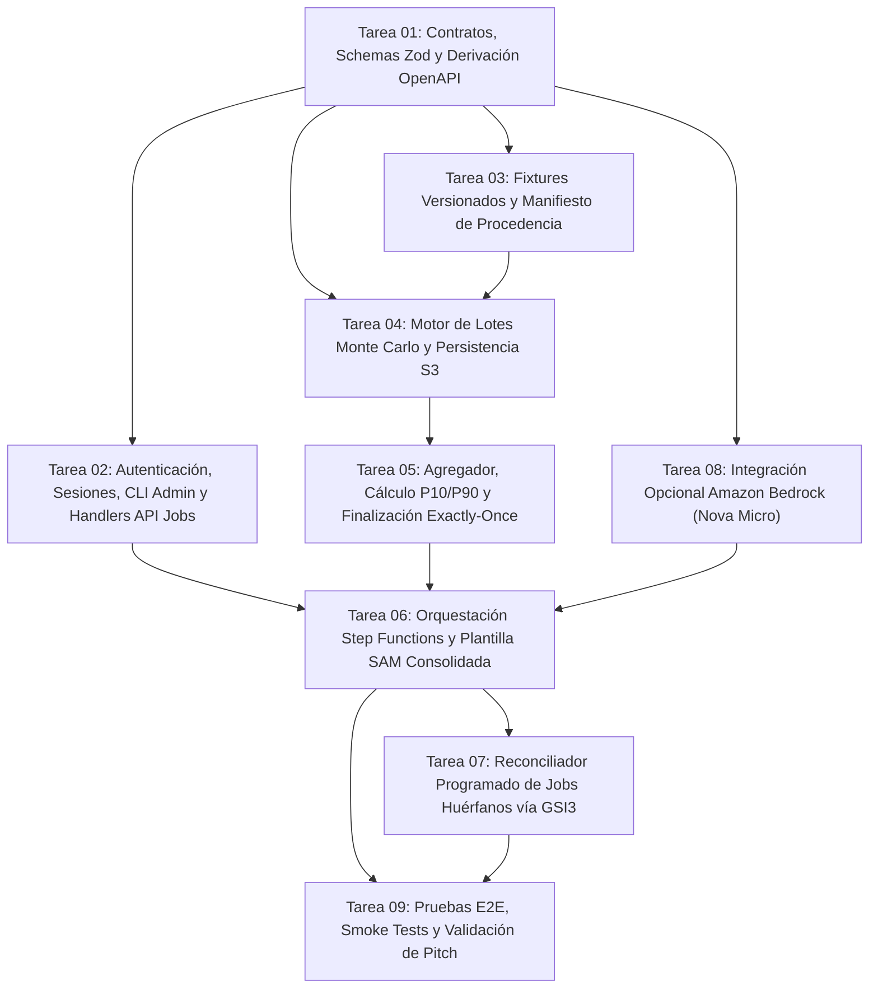

# Plan de Tareas de Implementación y Matriz Integral de Pruebas

> **Metodología de Desarrollo:** Test-Driven Development (TDD) estricto con ciclo RED -> GREEN -> REFACTOR por unidad de trabajo.  
> **Ámbito de Ejecución:** Paquete de 9 tareas independientes y ordenadas por dependencias para ejecución supervisada.  
> **Distinción Crítica:** Las 4 pruebas unitarias existentes en el repositorio ([`src/domain/__tests__/simulation.test.ts`](file:///C:/Users/MSI/BRAVO/Documents/ProyectosGit-2026/Yo/SpookythonAWS/src/domain/__tests__/simulation.test.ts)) están verificadas en local (`4 pass, 0 fail, 4957 expect(), 4.32s`). Todas las pruebas descritas en este documento son **pruebas planificadas que se crearán durante la implementación**.

---

## 1. Grafo de Dependencias de Implementación (DAG)

El orden de ejecución sigue una secuencia estrictamente lineal y libre de dependencias circulares (garantizando un único escritor secuencial sobre el árbol compartido):

---

## 2. Desglose Detallado de Unidades de Trabajo

### Tarea 01: Contratos de Dominio, Esquemas Zod y Derivación OpenAPI
* **Objetivo:** Establecer esquemas de validación estrictos en tiempo de ejecución para todos los parámetros de entrada (17 campos exactos de `SimulationParams` y enum `StrategyType`), respuestas de API, estados de DynamoDB y especificaciones de políticas IA.
* **Archivos a Crear:**
  * `src/domain/schemas/simulationParams.schema.ts`: Esquema Zod con límites numéricos estrictos:
    * `betaHuman`, `betaVector`, `sigma`, `gamma`: floats en `[0.01, 1.0]`.
    * `hospitalCapacity`: integer en `[100, 10000]` (interpretado como umbral de contingencia municipal).
    * `vaccineEfficacy`: float en `[0.10, 1.0]`.
    * `dailyBudget`: integer en `[100, 10000]`.
    * `vaccineCost`, `vaccineBatchSize`, `fumigationCost`, `cordonCost`: integers en `[1, 5000]`.
    * `days`: integer en `[1, 60]`.
    * `seed`: unsigned 32-bit integer `[1, 4294967295]`.
    * `monteCarloRuns`: integer en `[10, 500]`.
    * `patientZeroIds`: array de strings válidos (`N01`..`N16`).
    * `initialInfectedPerNode`, `initialExposedPerNode`: integers en `[0, 500]`.
  * `src/domain/schemas/api.schema.ts`: Esquemas para `POST /api/v1/auth/session` (código >=128 bits), `POST /api/v1/jobs` (cabecera `Idempotency-Key` obligatoria), `GET /api/v1/jobs`, `GET /api/v1/jobs/shared`, respuestas y errores.
  * `src/domain/schemas/aiPolicy.schema.ts`: Esquema estricto para la política declarativa de Bedrock (pesos normalizados sum <= 1.0, sin eval).
  * `scripts/generate-openapi.ts`: Script para generar el archivo `docs/contracts/openapi.yaml` a partir de los esquemas Zod.
* **Prueba RED Previa:** `src/domain/__tests__/schemas.test.ts`. Debe fallar inicialmente probando rechazos de valores negativos, NaN, claves desconocidas, días fuera de `1..60` y strings maliciosos.
* **Criterio de Aceptación (GREEN):** Pasan todas las pruebas de validación; OpenAPI 3.1 generado sin discrepancias con el código.

---

### Tarea 02: Autenticación por Invitaciones, Sesiones Opacas, CLI Admin y Handlers de API de Jobs
* **Objetivo:** Implementar la lógica de verificación de códigos de alta entropía (>=128 bits criptográficos), emisión de tokens de sesión opacos (>=256 bits), almacenamiento exclusivo de hashes SHA-256 en DynamoDB, CLI administrativo y la lógica de endpoints para la admisión transaccional de Jobs (`POST /jobs`), consulta de trabajos propios (`GET /jobs`), galería compartida (`GET /jobs/shared`), consulta de estado (`GET /jobs/{id}`), resultados autenticados (`GET /jobs/{id}/results`) y visibilidad (`PATCH /jobs/{id}/visibility`).
* **Archivos a Crear:**
  * `backend/auth/invitationService.ts`: Hashing de códigos, resolución determinista `CODE#<codeHash>` -> `invitationId`, validación de estado activo y verificación de expiración (7 días).
  * `backend/auth/sessionService.ts`: Emisión de tokens de sesión aleatorios de 256 bits, hashing y verificación contra DynamoDB con resolución de `invitationKey`.
  * `backend/auth/cookieHelper.ts`: Generación de encabezados `Set-Cookie` (`HttpOnly; Secure; SameSite=Strict`).
  * `backend/services/jobAdmissionService.ts`: Transacción atómica de 5 operaciones (`TransactWriteItems`: cuota global < 100, cuota invitación < 20, slot activo < 1, creación de job `slotReleased = false`, registro de idempotencia con `payloadHash`).
  * `backend/services/jobQueryService.ts`: Listado de trabajos propios vía `GSI1`, listado de galería compartida vía `GSI2` con **re-verificación fuerte en tabla base**, y proxy de resultados desde S3 con compresión gzip.
  * `scripts/admin-invitations.ts`: CLI local para que los administradores creen o revoquen invitaciones con roles IAM.
* **Prueba RED Previa:** `backend/__tests__/authAndJobsApi.test.ts`. Evalúa colisiones de hash, rechazo de códigos expirados, carreras de concurrencia en idempotencia, límites de cuota diaria y aislamiento estricto de jobs privados.
* **Criterio de Aceptación (GREEN):** Pruebas de autenticación y admisión de jobs pasando; el CLI genera códigos de alta entropía; transacción atómica impide carreras de slots; 401 uniforme ante credenciales inválidas.

---

### Tarea 03: Fixtures Versionados de Datos y Trazabilidad de Procedencia
* **Objetivo:** Crear los scripts reproducibles para compilar snapshots de demografía censal, clima y grafo urbano en fixtures JSON inmutables con comprobación de checksums y etiquetas metodológicas honestas (`[OBSERVADO OFICIAL]`, `[ESTIMADO EN MALLA]`, `[PROXY NO CALIBRADO]`, `[PARÁMETRO EDUCATIVO]`).
* **Archivos a Crear:**
  * `scripts/ingest-fixtures.ts`: Script que lee las fuentes locales descargadas, valida esquemas y emite los JSONs definitivos.
  * `src/data/fixtures/manta-nodes.json`: Fixture inmutable de los 16 nodos urbanos.
  * `src/data/fixtures/climate-manta.json`: Serie climática diaria de 60 días.
  * `src/data/fixtures/provenance-manifest.json`: Manifiesto formal de procedencia con hashes SHA-256.
* **Prueba RED Previa:** `src/data/__tests__/fixturesProvenance.test.ts`. Falla si falta un checksum, si la población nodal difiere de 264.281 hab. o si se detectan datos personales (PII).
* **Criterio de Aceptación (GREEN):** Fixtures generados y verificados en pruebas; cero accesos de red requeridos durante las pruebas.

---

### Tarea 04: Motor de Lotes Monte Carlo Headless y Persistencia Parcial en S3
* **Objetivo:** Adaptar el motor de simulación para ejecutarse en lotes discretos de 25 corridas dentro de una función AWS Lambda en Node.js 22 (ARM64), preservando la matemática y las semillas existentes (incluyendo el salting de RNG por estrategia `params.seed ^ 0x13579bdf`), escribiendo resultados parciales en S3 bajo rutas inmutables por intento y registrando recibos idempotentes con fencing de intento en DynamoDB.
* **Archivos a Crear:**
  * `backend/workers/batchWorker.ts`: Handler Lambda que recibe `{ jobId, attempt, strategy, batchIndex, startRunIndex, runsCount, params, aiPolicySpec }` y ejecuta las 25 corridas.
  * `backend/storage/s3Client.ts`: Cliente de almacenamiento S3 para guardar `jobs/<jobId>/attempts/<attempt>/batches/<strategy>_<batchIndex>.json.gz`.
* **Prueba RED Previa:** `backend/__tests__/batchWorker.test.ts`. Falla si las corridas de lote difieren de la ejecución monolítica de referencia para el mismo seed/runIndex, o si un intento antiguo sobrescribe un lote más reciente.
* **Criterio de Aceptación (GREEN):** Paridad numérica determinista comprobada al 100%; el lote de 25 corridas se ejecuta en < 2 segundos en ARM64 y persiste su JSON en S3 bajo ruta inmutable indexada por attempt.

---

### Tarea 05: Agregador de Resultados, Cálculo P10/P90 y Finalización Exactly-Once
* **Objetivo:** Implementar la Lambda de agregación que consolida los 20 lotes por estrategia, valida el manifiesto de 500 corridas (1.500 o 2.000 totales), calcula las bandas agregadas P10, Media y P90 (sin promediar percentiles), extrae la corrida representativa `run0` y ejecuta la **transacción condicional de finalización exactly-once** en DynamoDB (`slotReleased = false AND attempt = currentAttempt`), marcando el job como `COMPLETED` y liberando el slot de la invitación de forma atómica.
* **Archivos a Crear:**
  * `backend/workers/aggregator.ts`: Handler Lambda de consolidación final y transacción de cierre.
  * `backend/math/percentileAggregator.ts`: Algoritmo de percentiles exacto que preserva el cálculo del motor original.
* **Prueba RED Previa:** `backend/__tests__/aggregator.test.ts`. Falla si falta algún lote del manifiesto, si promedia percentiles incorrectamente, o si un segundo intento de finalización decremente el slot de concurrencia una segunda vez.
* **Criterio de Aceptación (GREEN):** Consolidación exitosa de 1.500 corridas en < 3,5 segundos; resultado final idéntico al motor local de referencia; slot liberado exactamente una vez.

---

### Tarea 08: Integración Opcional con Amazon Bedrock (Nova Micro)
* **Objetivo:** Desarrollar el generador de política declarativa con Amazon Bedrock usando la Converse API (`amazon.nova-micro-v1:0` en `us-east-1`). Implementar presupuesto estricto de máximo 2 llamadas por job, reserva persistente previa en DynamoDB (`AI_ATTEMPT#...`), cliente con `maxAttempts: 1`, timeout de 15 s, validación de esquema JSON estricto (sum <= 1.0, sin eval), caché determinista aislada y fallback determinista transparente a `SMART_CORTAFUEGOS` con salting de RNG idéntico.
* **Archivos a Crear:**
  * `backend/ai/bedrockPolicyGenerator.ts`: Cliente Bedrock con presupuesto de 1024 tokens, timeout de 15 s y reserva en DynamoDB.
  * `backend/ai/promptTemplates.ts`: Prompt estructurado (< 8 KB) que solicita la política JSON acotada.
  * `backend/ai/policyInterpreter.ts`: Adaptador que traduce la política declarativa en decisiones diarias dentro del motor numérico.
* **Prueba RED Previa:** `backend/__tests__/aiPolicy.test.ts`. Falla si la IA devuelve un JSON no conforme, si intenta ejecutar código arbitrario, si excede el presupuesto de 2 llamadas, o si no activa el fallback en caso de `ThrottlingException`.
* **Criterio de Aceptación (GREEN):** Fallback probado y verificado con etiqueta de procedencia explícita; reserva transaccional impide más de 2 llamadas; cuando Bedrock responde correctamente, la política respeta estrictamente los invariantes de presupuesto.

---

### Tarea 06: Orquestación con Step Functions y Definición SAM Consolidada
* **Objetivo:** Construir la máquina de estados en Step Functions con Inline Map acotado (`MaxConcurrency: 4`, sin bloques `Catch` globales en raíz, aplicando `Catch` en Tasks/Map), desplegar la plantilla SAM actualizada con Node.js 22 ARM64, configurar el índice disperso `GSI3` en DynamoDB, configurar los roles IAM de mínimo privilegio (retirando Bedrock de los workers) y enlazar el enrutador HTTP API de API Gateway.
* **Archivos a Crear/Modificar:**
  * `infra/statemachine/monteCarloWorkflow.asl.json`: Definición ASL de la máquina de estados con manejo de errores por estado.
  * `infra/template.yaml`: Plantilla SAM consolidada (roles IAM acotados, `SpookythonBackendTable` con `GSI1`, `GSI2`, `GSI3`, bucket S3 privado con regla de ciclo de vida de 7 días, alerta de AWS Budgets a $5.00 USD).
  * `backend/handlers/apiHandler.ts`: Enrutador REST v1 (`/api/v1/auth/session`, `/api/v1/jobs`, etc.) que rechaza rutas no autorizadas o legacy con 404/410 antes de invocar cómputo.
* **Prueba RED Previa:** `infra/__tests__/samTemplateValidation.test.ts`. Falla si la plantilla contiene comodines `*` en acciones IAM sensibles, si los workers tienen permisos de Bedrock o si la máquina de estados intenta declarar un Catch raíz.
* **Criterio de Aceptación (GREEN):** `sam validate` exitoso; máquina de estados sintácticamente válida con cuotas de concurrencia respetadas; roles IAM de mínimo privilegio auditados.

---

### Tarea 07: Reconciliador Programado de Trabajos Huérfanos vía GSI3
* **Objetivo:** Implementar la función Lambda programada mediante EventBridge (cada 5 minutos) que consulta el índice disperso `GSI3` para identificar jobs en estado `PENDING` o `RUNNING` con más de 15 minutos de antigüedad (`dueTimeIso <= NOW()`). Inspecciona el estado en Step Functions con `DescribeExecution`, reconcilia arranques inciertos o cierra jobs huérfanos con la misma transacción condicional exactly-once (`slotReleased = false`), liberando el slot de concurrencia sin carreras.
* **Archivos a Crear:**
  * `backend/reconciliation/reconciler.ts`: Handler de reconciliación disparado por EventBridge.
  * `backend/reconciliation/cleanupService.ts`: Lógica de consulta a `GSI3`, llamada a `DescribeExecution` y transacción atómica condicional de marcado `TIMED_OUT` y liberación de slot.
* **Prueba RED Previa:** `backend/__tests__/reconciler.test.ts`. Simula caídas antes de `StartExecution`, workflows abortados y verifica que la consulta sobre `GSI3` recupere los jobs y libere los slots sin tocar jobs activos dentro de su ventana de 15 minutos.
* **Criterio de Aceptación (GREEN):** Reconciliador probado en escenarios de timeout; cero bloqueos de slots para usuarios legítimos; exactamente una liberación de slot por job.

---

### Tarea 09: Suite E2E, Smoke Tests y Validación Final de Pitch
* **Objetivo:** Ejecutar la batería de pruebas de integración extremo a extremo en entorno cloud o emulado, validando el aislamiento entre 2 códigos de invitación independientes, revocación de códigos, expiración de sesiones, conmutación de visibilidad compartida con re-chequeo fuerte, deduplicación de idempotencia, y validación de invocación real de Bedrock frente a fallback determinista.
* **Archivos a Crear:**
  * `tests/e2e/twoInvitationsFlow.test.ts`: Prueba de no interferencia, aislamiento de datos, revocación de sesión y visibilidad compartida entre jurados.
  * `tests/e2e/jobLifecycleSmoke.test.ts`: Prueba de ciclo completo desde `POST /api/v1/jobs` hasta `GET /results` con 1.500 corridas y validación de paridad numérica.
  * `scripts/smoke-test.sh`: Script ejecutable para verificar la salud del backend tras el despliegue.
* **Prueba RED Previa:** Ejecución del flujo E2E contra endpoints no levantados (falla por conexión rechazada).
* **Criterio de Aceptación (GREEN):** Suite E2E completa en verde; tiempo total de respuesta para 1.500 corridas `< 45 segundos`; aislamiento estricto demostrado entre invitaciones.

---

## 3. Matriz Exhaustiva de Pruebas

| Nivel de Prueba | Alcance y Propósito | Herramienta / Comando | Criterio de Aprobación |
| :--- | :--- | :--- | :--- |
| **Pruebas Unitarias de Dominio** | Paridad matemática del motor SEIR-V, conservación de población, regla de oro de vacunación y determinismo de PRNG con salting de estrategia. | `bun test src/domain/__tests__/simulation.test.ts` *(Existente y verificada en local)* | 4 pruebas pasando, 0 fallos, 4.957 assertions en < 5 s. |
| **Pruebas de Esquemas y Contratos** | Validación de tipos Zod para los 17 campos exactos de `SimulationParams`, enum `StrategyType`, días 1..60, y rechazo de payloads maliciosos. | `bun test src/domain/__tests__/schemas.test.ts` *(Planificada / A crear)* | 100% de casos borde y cargas maliciosas rechazadas con código 400. |
| **Pruebas de Autenticación y Acceso** | Verificación de hashing SHA-256 de códigos (>=128 bits) y tokens (>=256 bits), expiración de sesiones (12h/7d) y error 401 opaco uniforme. | `bun test backend/__tests__/authAndJobsApi.test.ts` *(Planificada / A crear)* | Tokens en texto claro nunca persistidos; error 401 idéntico en tiempo constante. |
| **Pruebas de Carreras de Idempotencia y Cuota Global** | Validación de transacción atómica de 5 operaciones, rechazo de colisiones con payload distinto (409) y respeto de cuotas (20/invitación, 100 global). | `bun test backend/__tests__/idempotencyAndQuotaRaces.test.ts` *(Planificada / A crear)* | Reintentos con misma clave devuelven job sin duplicar cuota; peticiones concurrentes nunca exceden límites. |
| **Pruebas de Fencing de Intentos y Finalización Exactly-Once** | Simulación de workers tardíos o reintentos; verificación de que solo el intento activo con `slotReleased = false` libere el slot de la invitación. | `bun test backend/__tests__/attemptFencingAndRelease.test.ts` *(Planificada / A crear)* | Workers desfasados no pueden sobrescribir lotes ni decrementar slots de trabajos posteriores. |
| **Pruebas de Paridad Matemática de 500 Corridas** | Comparación bit a bit de 500 corridas en lotes de 25 ejecutadas en Lambda frente a la ejecución monolítica de referencia para el mismo seed. | `bun test backend/__tests__/monteCarloParity500.test.ts` *(Planificada / A crear)* | Resultados estadísticos (P10, Media, P90) y `run0` coinciden de forma determinista y exacta. |
| **Pruebas de Resiliencia y Reserva de Intentos IA** | Verificación de reserva persistente de intentos en DynamoDB (máximo 2 totales), fallback transparente a `SMART_CORTAFUEGOS` y probe en vivo. | `bun test backend/__tests__/aiPolicy.test.ts` *(Planificada / A crear)* | Fallback suave sin errores al usuario; etiqueta de procedencia explícita; cero excedente de llamadas a Bedrock. |
| **Pruebas de Empaquetado y Node 22** | Verificación de que el bundle generado por esbuild se ejecuta limpiamente en el entorno de Node.js 22 nativo (ARM64) sin dependencias de Bun. | `node scripts/node-smoke-check.mjs` *(Planificada / A crear)* | Cero errores de resolución modular de AWS SDK v3; arranque en frío `< 250 ms`. |
| **Pruebas de Máquina de Estados y Plantilla SAM** | Validación sintáctica de la plantilla SAM y definición ASL de Step Functions (sin bloques Catch en raíz). | `sam validate --template-file infra/template.yaml` *(Planificada / A crear)* | Sintaxis SAM válida; cuotas de concurrencia acotadas a 4; roles IAM de mínimo privilegio. |
| **Pruebas E2E de Privacidad, Compartición y Revocación** | Validación de aislamiento estricto entre 2 invitaciones, re-verificación fuerte en tabla base para galería compartida y revocación en tiempo real. | `bun test tests/e2e/twoInvitationsFlow.test.ts` *(Planificada / A crear)* | Usuario B no puede acceder a trabajos privados de A; revocación de invitación bloquea el acceso inmediatamente. |
| **Auditoría de Costos y Recursos** | Comprobación de que la alarma de AWS Budgets ($5.00 USD) está configurada en SAM y logs de CloudWatch con retención de 7 días. | Inspección de plantilla SAM y script preflight *(Planificada / A crear)* | Cero recursos abiertos sin control de costos; retención estricta de CloudWatch Logs a 7 días. |
