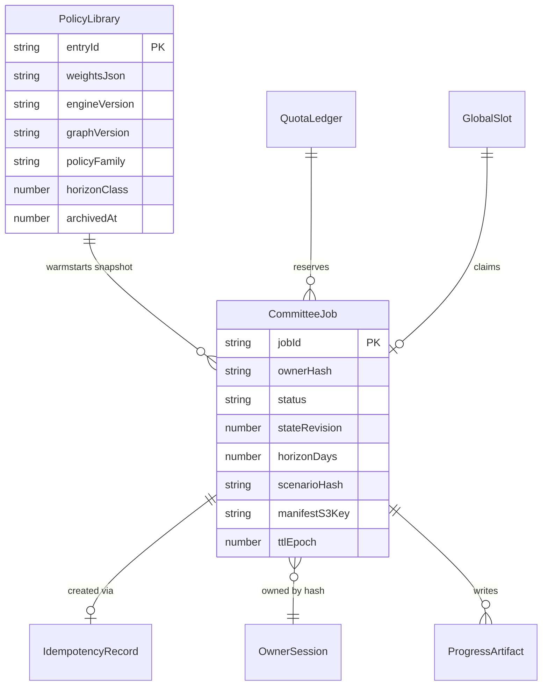

# Data model — committee-learning

Brownfield: DynamoDB on-demand (no SQL migrations live). Este documento define items/keys de **CommitteeTable** nueva y objetos S3 del bucket de resultados. No se escribe en `SpookythonSimulations` ni en el frontend bucket.

## Aggregate map

| Aggregate | Root | Children / artifacts |
| --- | --- | --- |
| CommitteeJob | `JOB#<jobId>` | status, pointers S3, cancel flags |
| QuotaLedger | `QUOTA#GLOBAL#<yyyyMM>` / `QUOTA#OWNER#<ownerHash>#<yyyyMMdd>` | counters |
| GlobalSlot | `SLOT#GLOBAL` | activeJobId |
| IdempotencyRecord | `IDEM#<ownerHash>#<keyHash>` | jobId |
| PolicyLibrary | `LIB#POLICY#<entryId>` | weights + compat |
| S3 artifacts | `s3://committee-results/...` | manifest, snapshots, ledger, progress |

## ER (lógico)



## DynamoDB keys

| Entity | PK | SK | Attributes (principales) | Condition notes |
| --- | --- | --- | --- | --- |
| Job | `JOB#<uuid>` | `META` | ownerHash, status, stateRevision, cancelRequested, recommendedPolicyVersion, progressPolicyVersion, finalAuditStatus, scenario, horizonDays, createdAt, updatedAt, softDeadlineAt, hardDeadlineAt, reservedGbs, manifestKey, resultPrefix, idempotencyKeyHash, ttl | Create if not exists; terminal CAS `status` in active set; `stateRevision` exact match on publish |
| Idempotency | `IDEM#<ownerHash>#<keyHash>` | `META` | jobId, payloadHash, createdAt, ttl | Put if not exists → return existing jobId |
| Global slot | `SLOT#GLOBAL` | `META` | activeJobId, holderOwnerHash, leasedAt, ttlSoft | activeJobId attribute_not_exists or = pending clear |
| Month quota | `QUOTA#GLOBAL#<yyyyMM>` | `META` | jobsCount, gbsReserved, ttl | jobsCount < 100 AND gbsReserved + 1200 ≤ 120000 |
| Day session quota | `QUOTA#OWNER#<ownerHash>#<yyyyMMdd>` | `META` | jobsCount, ttl | jobsCount < 5 |
| Library entry | `LIB#POLICY#<entryId>` | `META` | w0..w3, engineVersion, graphVersion, policyFamily, horizonClass, scoreHint, archivedAt, ttlOptional | Max 8 via controlled write path |

**TTL attribute:** `ttl` epoch seconds. **No GSI required for v1** si status/cancel van por PK directa; si se añade reconciliación por scan acotado, documentar GSI3 sparse `statusAge` en implementación solo con ADR amend.

## Job status enum

`queued` | `running` | `completed` | `no-improvement` | `cancelled` | `timed-out` | `failed`

## S3 layout (privado)

```
committee/<jobId>/manifest.json
committee/<jobId>/ledger.jsonl
committee/<jobId>/progress/v<n>.json
committee/<jobId>/final/audit.json
committee/<jobId>/playback/day-<d>.json
```

Reglas: PutObject antes de CAS DDB; objetos inmutables por key versionada; Block Public Access total; lifecycle expire 7 días; sin presigned URL v1.

## Admission transaction (lógica)

1. Read/create idempotency → si existe, return jobId (sin nueva reserva).
2. Transact: incr day quota, incr month jobs+gbs, claim slot, put job `queued`.
3. Invoke worker async.
4. Fallos: no partial quota without job; rollback conditions via transaction cancel.

## Staged migrations

DynamoDB no usa SQL. Inventario CloudFormation/SAM staged:

- `migrations/01_committee_table.md` — recurso tabla + TTL.
- `migrations/02_committee_results_bucket.md` — bucket + lifecycle + políticas.

Ver archivos en `migrations/`.
