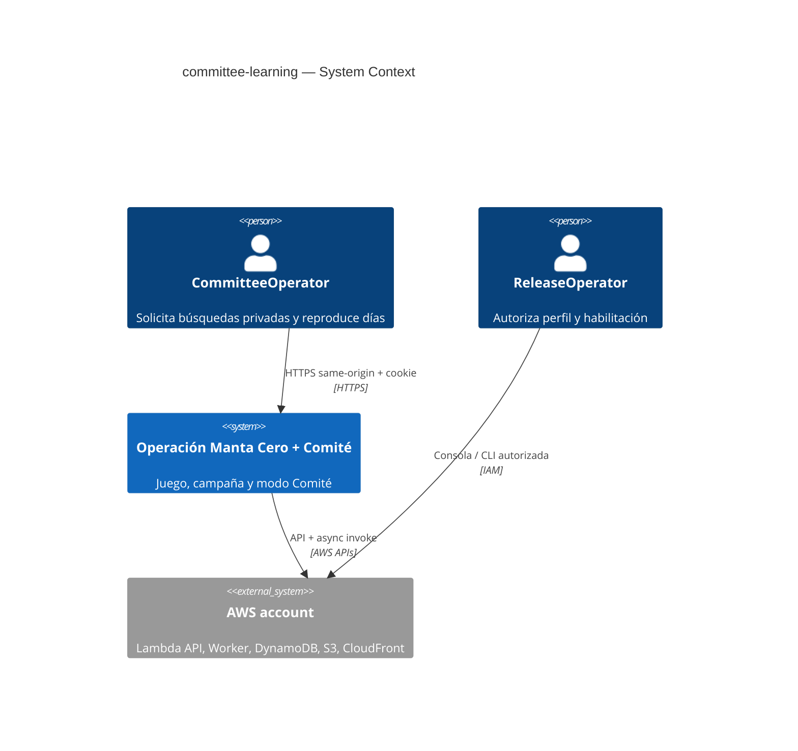
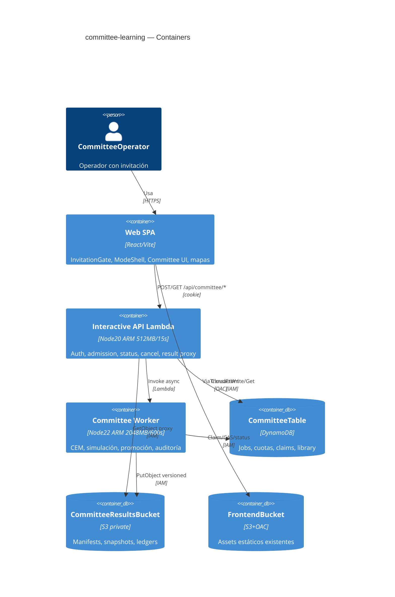
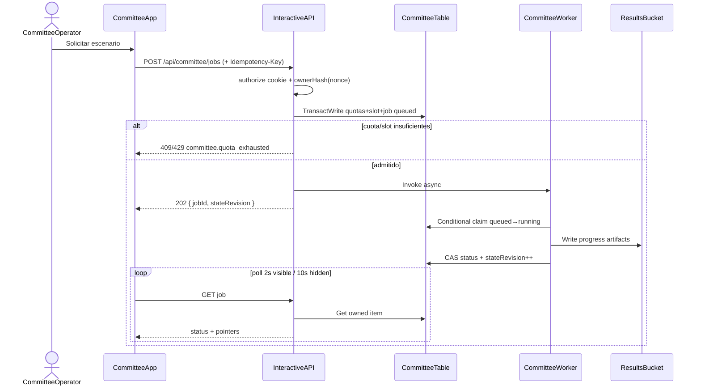

# Software Architecture Document — committee-learning

## 1. Introduction and goals

**Intent.** Agregar un modo Comité autenticado que busca y valida políticas explicables de contención mediante simulaciones acotadas en AWS, mostrando avance diario y recomendaciones progresivas, sin alterar el juego manual ni la campaña de cura.

**Top-3 quality goals:**

1. Aislamiento estricto de trabajos y resultados por sesión propietaria.
2. Honestidad estadística: baseline primero, promoción solo con evidencia, auditoría final intacta.
3. Consumo acotado y cancelable bajo el objetivo de diseño de 5 USD/mes (reservas conservadoras, no techo duro de factura).

**Stakeholders.**

| Role | Interest | Sign-off owner? |
| --- | --- | --- |
| CommitteeOperator | Solicitar/consultar/cancelar búsquedas y reproducir días | No |
| ReleaseOperator | Perfil, cuotas cloud, habilitar entrenamiento, publicación | Yes (gates externos) |
| Tech Lead | SAD / contratos / release local | Yes |
| Security Lead | AuthZ por ownerHash, S3 privado, anti-enumeración | Yes |

<!-- brownfield HEAD 4bcdc6e: InvitationGate lazy-App; auth cookie manta_session; SAM Node20 ARM 512MB/15s; ModeShell aún no existe. -->

## 2. Constraints

**Technical.**
- Frontend: React 19 + Vite + Bun; mapas `CureEarth3DMap` / `CureCityMap`.
- Dominio: `runSingleSeirSimulation(params, strategy, runIndex, manualActions?)` en `src/domain/seirEngine.ts`; `StrategyType` legado sin valor LEARNED.
- API interactiva existente: HTTP API + `backend/handler.ts`, Node 20 ARM, 512 MB / 15 s — **no** alargar deadline para aprendizaje.
- Persistencia actual: tabla `SpookythonSimulations` solo `scenarioKey` (sin uso transaccional del handler vivo); bucket frontend + OAC. Comité usa tabla y bucket de resultados **nuevos**.
- Worker dedicado: Node 22 ARM, 2048 MB, timeout 600 s hard / soft budget 480 s, ≤ 4096 trayectorias.

**Organisational.**
- Plan completo para agente coding-only; un escritor; sin OpenCode.
- Sin deploy/entrenamiento sin autorización ReleaseOperator.
- Crédito 140 USD informado, no verificado.

**Conventions.**
- Identificadores/schemas en inglés; docs de plan en español.
- Conventional Commits; sin auto-commit en esta fase.
- Errores API: envelope `{ code, message, details? }` con `module.error_name`.

**Regulatory / external.**
- Retención lógica y lifecycle S3/DDB/logs: 7 días (supuesto arquitecto).
- Sin datos clínicos personales nuevos; escenarios ficticios educativos.

## 3. Context and scope

CommitteeOperator, tras invitación válida, abre Comité, lanza una búsqueda privada y observa baseline → mejoras progresivas → auditoría final. El cómputo pesado ocurre en un worker asíncrono; el navegador solo admite, consulta y reproduce artefactos autorizados.

**External systems (in / out):**

| Actor or system | Type | Interaction |
| --- | --- | --- |
| CommitteeOperator | Person | UI Comité / polling / playback |
| ReleaseOperator | Person | Perfil, flags, autorización (fuera de app) |
| Invitation auth (existente) | System (internal) | Cookie `manta_session` |
| DynamoDB CommitteeTable | System (internal) | Metadata, cuotas, claims, library |
| S3 results bucket (privado) | System (internal) | Artefactos versionados |
| CloudWatch Logs | System (internal) | Logs 7 días |
| Bedrock / LLM / GPU | System (external) | **Fuera de alcance v1** |

**C4 Context (L1):**



## 4. Solution strategy

1. **Modo UI separado** (`ModeShell`) que mantiene `App` montado/oculto al alternar; Comité no inyecta acciones al juego.
2. **API autenticada delgada** (start/status/cancel/result proxy) en el runtime interactivo existente; **worker Lambda dedicado** para hasta 3552 trayectorias de protocolo.
3. **Admisión atómica** de cuotas + slot global 1 + idempotency por owner/payload antes de invocar el worker.
4. **Familia de 4 pesos** + CEM + promoción progresiva + FinalAudit intacta (`algorithm.md`).
5. **RNG ambiental independiente de política** para comparaciones pareadas; seam opcional en el motor sin romper paridad de 4 argumentos.
6. **Library global** solo de pesos compatibles (máx. 8), sin filtrar datos privados.

`target_surfaces`: `web-frontend` (SPA existente), `backend-service` (handler API), `worker` (CommitteeWorker).

UI-architecture: SPA Vite existente; estado Comité local + polling; sin SSR.

## 5. Building block view (C4 Container)



**Building blocks:**

| Block | Responsibility | Collaborators |
| --- | --- | --- |
| ModeShell | Alternar Juego / Campaña / Comité sin desmontar App | InvitationGate, App, CommitteeApp |
| CommitteeApp | Formulario escenario, poll, playback | API client, Cure*Map adapters |
| Auth helpers | Validar cookie; derivar ownerHash de nonce | backend/auth.ts |
| AdmissionService | Cuotas, slot, idempotency, enqueue | DynamoDB |
| CommitteeWorker | Protocolo algorithm.md | seirEngine seam, S3, DDB |
| PolicyLibrary | CRUD pesos compatibles | DDB |
| ResultStore | Artefactos inmutables + CAS pointer | S3, DDB |

## 6. Runtime view

### 6.1 Start job (happy)



### 6.2 Cancel / timeout / duplicate

```mermaid
sequenceDiagram
    actor Op as CommitteeOperator
    participant API as InteractiveAPI
    participant DDB as CommitteeTable
    participant W as CommitteeWorker

    Op->>API: POST cancel
    API->>DDB: Mark cancelRequested if owner
    W->>DDB: Check cancel before each trajectory
    alt soft/hard timeout
        W->>DDB: CAS terminal timed-out; keep last ProgressVersion; finalAudit=not-run
    else cancel
        W->>DDB: CAS terminal cancelled
    else duplicate async invoke
        W->>DDB: Claim fails → exit without recompute
    end
```

### 6.3 Reconciliation (admission/status path, bounded)

Al admitir o consultar: fallar `queued` expirados; marcar `running` vencidos (`timed-out`/`failed`); liberar slot si claim terminal incompleto. TTL **no** es corrector. `AsyncMaximumRetryAttempts=0`, event age 120 s; claim una sola vez.

## 7. Deployment view

- Región: la del stack SAM existente (verificar antes de deploy).
- Añadir `CommitteeWorkerFunction` + event invoke desde API; `CommitteeTable`; `CommitteeResultsBucket` (Block Public Access, sin website hosting).
- No Step Functions / SageMaker / EC2 / una tarea por trayectoria.
- ReservedConcurrentExecutions=1 es **hardening opcional** con evidencia de cuota; no requisito de admisión v1 (el slot DDB es la fuente de verdad).
- Perfil maintenance-only: flag que limita a ≤3 jobs acotados antes de habilitar training completo.

## 8. Cross-cutting concepts

**AuthZ.** Toda ruta verifica sesión vigente y `ownerHash === job.ownerHash`. Respuestas de no-propiedad: mismo denegado genérico sin filtrar existencia (AC-04). Nuevo login → nuevo nonce → pierde acceso a jobs de sesión anterior (documentado en UI).

**Idempotency.** Clave por owner + hash canónico de payload; reintento no crea segundo job ni segunda reserva.

**Observability.** `stateRevision` monotónico; ledger de trayectorias; sin PII; sin volcar pesos ajenos.

**Privacy.** S3 privado; API proxy; sin signed URLs públicas v1; library sin owner/seeds.

**Domain seams.** Quinto argumento options opcional en `runSingleSeirSimulation` para callback diario / namespace env; salidas numéricas de 4 args idénticas. No añadir LEARNED a `StrategyType`.

## 9. Architecture decisions

| ID | Title | Status | SAD § |
| --- | --- | --- | --- |
| ADR-0001 | Run learning in a dedicated async worker Lambda | Accepted | §4–§5 |
| ADR-0002 | Derive job ownership from session nonce hash | Accepted | §8 |
| ADR-0003 | Use explainable four-weight CEM with progressive promotion | Accepted | §4 |
| ADR-0004 | Keep policy-independent environmental RNG namespaces | Accepted | §4 |
| ADR-0005 | Store artifacts in a private results bucket with CAS pointers | Accepted | §5 |
| ADR-0006 | Enforce atomic admission quotas and a single global slot | Accepted | §6 |
| ADR-0007 | Keep App mounted via ModeShell when switching modes | Accepted | §4 |
| ADR-0008 | Share only compatible weight vectors in a global library | Accepted | §4 |
| ADR-0009 | Bound retention to seven days for jobs and artifacts | Accepted | §2 |
| ADR-0010 | Require real cloud profiling before enabling training | Accepted | §7 |
| ADR-0011 | Extend simulator with optional fifth options argument | Accepted | §8 |

## 10. Quality requirements

| Scenario | When / Then | How-verify | Spec NFR |
| --- | --- | --- | --- |
| Interactive admission | When 2 req/s for 60 s on start/status | Then p95 ≤ 1500 ms without running search inline | NFR-01 |
| First baseline | When worker starts a valid job | Then baseline visible ≤ 30 s objective (cloud profile gate) | NFR-02 |
| Job bounds | When worker runs | Then ≤ 480 soft / 600 hard / 4096 trajectories | NFR-03 |
| Quotas | When monthly/session limits would exceed | Then reject without oversubscription; 1200 GB-s reserved/job no refund v1 | NFR-04 |
| Concurrency | When two jobs race | Then one active global; ≤5 admissions/session/day UTC | NFR-05 |
| Privacy | When foreign session queries jobId | Then deny without existence leak; logical retention 7d | NFR-06 |
| Polling/cancel | When UI visible/hidden / worker loops | Then 2 s / 10 s poll; cancel checked before each trajectory | NFR-07 |
| Publication | When promotions and status updates occur | Then ≤8 promotions; stateRevision always increases | NFR-08 |

## 11. Risks and technical debt

| Risk | Severity | Mitigation | Owner | Due |
| --- | --- | --- | --- | --- |
| Timings locales Bun≠Lambda ARM | High | Perfil cloud obligatorio antes de training | ReleaseOperator | Antes de habilitar |
| Crédito 140 USD no verificado | High | No descontar de estimaciones | ReleaseOperator | Antes de gastar |
| Async invoke duplicado | Medium | Claim condicional + retry 0 | Tech Lead | En implementación worker |
| Overfit / promoción falsa | High | FinalAudit intacta + Bonferroni | Tech Lead | En algorithm + tests |
| Slot colgado | Medium | Reconciliación acotada en status/admission | Tech Lead | En API tasks |
| Horizon 20–60 aún supuesto | Low | Fijado aquí; UI valida rango | Architect | Cerrado en este SAD |
| Open questions de brief aún abiertos en readiness | Medium | Actualizar brief solo al cerrar ingeniería | Tech Lead | Tras crítica paquete |

## 12. Glossary

Ver [`CONTEXT.md`](./CONTEXT.md). Términos clave: CommitteeJob, PolicyWeights, Incumbent, ProgressVersion, FinalAudit, PolicyLibrary, RunManifest, CumulativeInfections, LearningBudget, HeldOutSeeds.
