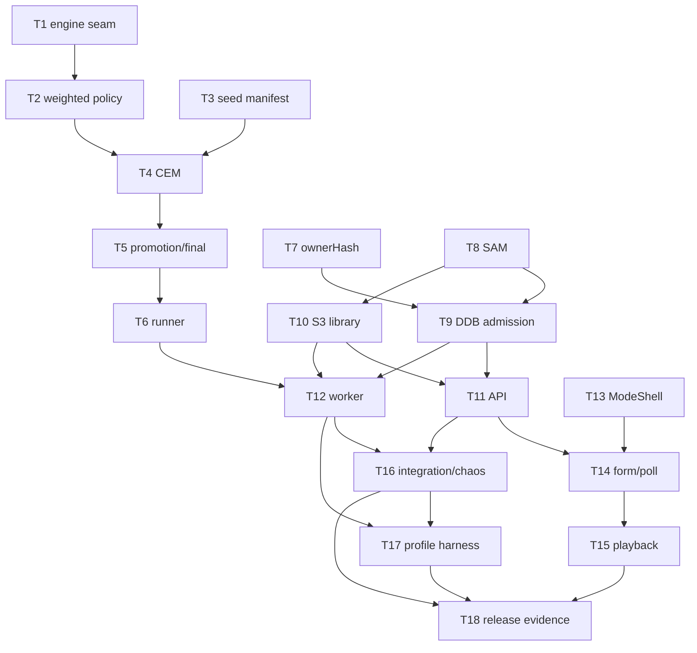

# Epic — committee-learning

Modo Comité: búsqueda privada asíncrona de políticas de 4 pesos con promoción progresiva y auditoría final, sin reemplazar juego/campaña.

## DAG

## Parallel waves

| Wave | Tasks |
| --- | --- |
| 1 | T1, T3, T7, T8, T13 |
| 2 | T2, T9, T10 |
| 3 | T4, T11 |
| 4 | T5, T14 |
| 5 | T6, T15 |
| 6 | T12 |
| 7 | T16 |
| 8 | T17 |
| 9 | T18 |

Serialize overlapping `files_hint` lanes (esp. `backend/handler.ts`, `src/InvitationGate.tsx`).

## Coding-only

Usar el prompt en [`../README.md`](../README.md). No deploy sin ReleaseOperator.
